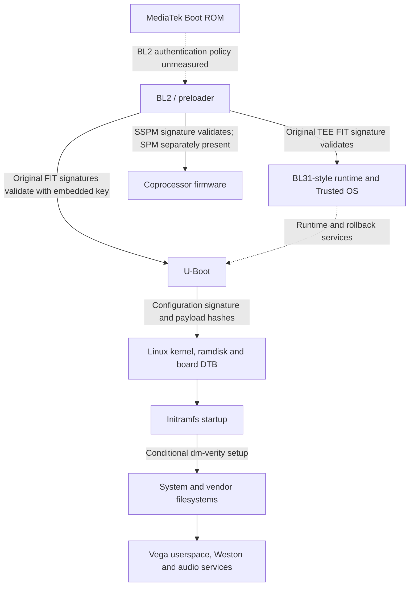

# Echo Show 5 Gen 3: firmware security and AI-pet feasibility

Updated 12 November 2026, Israel. Continuation of the existing investigation; no research restart. This current assessment supersedes earlier incomplete status statements in the historical notes retained after it.

## Result and evidence strength

**The inspected U-Boot contains the old verification behavior addressed by CVE-2026-46728, with a statically connected kernel-loading call path. Original-image cryptographic checks support that assessment. Exploitability on a locked retail Echo Show 5 Gen 3 is not established. No jailbreak or custom-image boot has been demonstrated.**

This pass adds three substantive results:

1. **Another boot-chain link was verified.** An embedded key device tree at BL2 file offset `0xcf0` contains a public `key-fit` record. That public key successfully verifies the original configuration signatures in `u-boot-mtk.bin`, `tee.img` and `sspm-fit.img`.
2. **Signature coverage was mapped explicitly.** For original `boot.img` configuration `conf-1`, the configuration's kernel/device-tree/ramdisk references, rollback version, image load/type metadata and payload-hash values are covered. The `hashed-nodes` value is not covered. All seven original embedded payload hashes match their declared SHA-256 values.
3. **Independent public evidence was differentiated.** An exact-model community report documents a displayed fastboot mode, and another reports serial-looking pad activity. Neither establishes a usable USB transport, a working serial console or custom-code execution. The reviewed community firmware projects still do not establish a hypnos port.

No device was accessed. All checks used original public firmware. No exploit input, altered boot image, forged signature, authorization change or bootloader emulation was constructed or executed. Cryptographic verification here means an independent cryptography library validated original signatures; it does not mean an independent researcher has reviewed this assessment.

## Target and preserved evidence

Target: Echo Show 5 third generation (2023), model H97N6S, codename `hypnos`, MediaTek MT8169 B/BV. Amazon's compliance notice establishes H97N6S as the retail model [S6]. Inspected main firmware is catalog build `7202000017420`, labeled Vega OS 2.0, recorded 5 November 2026. Catalog labels and download provenance are not a measurement of any user's installed version.

The existing boot, BL2, TEE, SSPM, extracted kernel configuration, filesystem inventories, disassembly, scripts, signature results and citations were retained. The earlier report text is reproduced unchanged in the historical appendix, and its prior versions remain preserved. New analysis scripts and JSON evidence were added separately.

The companion research bundle contains the scripts, machine-readable evidence, original small boot components, extracted configuration evidence and historical notes. Large system/vendor filesystem images remain unchanged in the working artifacts; they are omitted from the compact bundle, with download references, reconstruction scripts and fingerprints supplied instead. The bundle README identifies its exact contents and exclusions.

| Main original member | SHA-256 |
|---|---|
| U-Boot FIT | `157ef8534d4fbfcf85bd7c72c7c9ae7447e42086b3259fc5356c02af23ffcc93` |
| Kernel boot FIT | `c0aff41d028badda0b2781a60e358080f0aa8929c2742d0b7ce83c63ea39ec0a` |
| BL2 | `d2e14618886c18736149fe323da074f1210a7250eab6a89d736034f2e091eba2` |
| TEE FIT | `2cf2b341e66da605e75655d66c14037e5659eb8099bf57cabdc6d6eaf20fad26` |

The four checked, signature-verified manifests declare identical U-Boot, BL2 and TEE hashes. This supports the same declared boot components across those four packages, not every historical firmware version. No successful-unlock version cutoff is known.

## 1. Vulnerability assessment against the upstream fix

The primary upstream fix replaces reliance on the image-supplied `hashed-nodes` list with a list rebuilt from the selected configuration's image references [S2]. Current U-Boot documentation explicitly treats `hashed-nodes` as a signing record rather than trusted verification policy [S3].

| Proposition | Assessment | Basis and limitation |
|---|---|---|
| The recovered code reads `hashed-nodes`, parses its supplied path strings and uses them for region selection | **Confirmed statically** | Decoded instructions in the routine at `0x41e2a828`; the property read occurs around `0x41e2a900` |
| The old routine is connected to kernel image loading | **Confirmed static call path** | Direct calls through kernel loader, FIT loader and required-signature traversal; exact callsites retained in JSON/disassembly |
| That connection proves a particular retail device executes the path | **Unverified** | Verification flags, provisioning and runtime state were not measured on hardware |
| Original signatures are compatible with the reconstructed old signing-region calculation | **Confirmed offline** | All eight original `boot.img` configuration signatures validate with the compiled production public key |
| `hashed-nodes` is outside those original signed regions | **Confirmed for the checked configurations** | Explicit region/property coverage comparison, with successful signature validation as a consistency check |
| An unsigned `hashed-nodes` record alone proves a vulnerability | **Incorrect** | Fixed upstream code also treats it as an unsigned record; the important distinction is whether verification trusts it |
| Configuration-name and selected-configuration membership checks remove the old behavior | **Not supported** | These sanity checks are present, but do not reconstruct the complete required image/hash-node set as the published fix does |
| Missing per-image RSA signatures are inherently a security defect | **Incorrect** | Signed configurations plus authenticated payload hashes are a standard FIT design [S3] |
| A malicious image will be accepted by this exact binary | **Unverified** | No modified input or acceptance test was performed |
| The CVE supplies remote access or an image-upload interface | **Not established** | It concerns verification after image delivery; the delivery boundary remains separate |

**Code-level conclusion:** strong evidence of the affected verification pattern in this firmware snapshot. **Device-level conclusion:** a credible applicability candidate, not a demonstrated complete bypass. The investigation has not ruled out all compensating checks, alternate runtime paths or product-specific policies.

The routine uses public-key signature verification rather than accepting an arbitrary public key from the incoming image. Production key installation and error paths are present. This is a coverage-policy concern, not evidence of a recovered signing private key or broken RSA mathematics.

## 2. Boot chain and authentication responsibilities

The diagram maps all relevant components established by the artifacts, with unknown transitions labeled. It is not a hardware-observed boot trace.

| Stage or transition | What the artifacts establish | What remains unknown |
|---|---|---|
| Boot ROM to BL2 | BL2 has MediaTek `EMMC_BOOT`/`BRLYT`/`FILE_INFO` packaging; update metadata writes it to the eMMC boot region | ROM implementation, fused root key/hash, exact signature enforcement and live production settings |
| BL2 to U-Boot | BL2 embeds a `key-fit` public RSA record; it validates the original outer U-Boot FIT signature; BL2 includes FIT/security/anti-rollback code and diagnostics | Exhaustive BL2 control flow and enforcement for every live security state |
| BL2 to secure-world components | `tee.img` signature validates with the embedded BL2 FIT key; its payloads include BL31-specific platform/runtime strings and Trusted OS/OP-TEE source-path evidence | Full secure-world code audit and exact boot handoff ordering on hardware |
| BL2 to coprocessors | Signed SSPM FIT validates with the same key; SPM firmware is a separate archive member | SPM's separate authentication details and peripheral enforcement policies |
| U-Boot to Linux boot components | Trusted production public key, required-configuration verification, direct loader calls, original signature checks and original payload hash checks | Acceptance of altered images and every runtime selection/policy condition |
| Linux to initramfs | Original FIT contains kernel and ramdisk, bound through the configuration's signed hash metadata | Hardware boot execution was not observed |
| Initramfs to system/vendor | Packaged verity root hashes and mapper setup code exist; bootloader supplies verity state | Actual deployed kernel command line, mapper state and board/provisioning differences |
| System to userspace | Extracted service definitions, ELF32 ARM files, Smack configuration, Weston and audio configuration | Whether a custom app can be authorized, launched and granted the necessary hardware access |

The BL2 `key-fit` record is distinct from the production key record compiled into U-Boot for kernel FIT verification. A separate BL2 `key-da` record is also present. The existence of that key suggests a download-agent trust mechanism, but no download-agent image or usable retail download-agent interface was validated.

The successful new checks are recorded in `boot-chain-signature-checks.json`: U-Boot FIT, TEE FIT and SSPM FIT, all original and unmodified. These prove key/signature relationships. They do not cryptographically authenticate BL2 itself against a hardware fuse root.

MediaTek's Genio secure-boot documentation explains Boot ROM/eFuse trust mechanisms on related platforms [S4]. It is architectural background only. Its TF-A/FIP, UEFI/GRUB and RSA-3072 examples must not be substituted for hypnos evidence. This device's observed downstream packages are FITs; no GRUB/UEFI boot sequence was established.

## 3. Signature coverage versus boot policy

The new field-level inventory is in `verification-boundaries.json`. Results below are for the original `conf-1` configuration; all eight original configuration signatures were separately validated.

| Item | Directly within this signature's covered regions? | Security interpretation |
|---|---|---|
| Selected configuration's kernel/FDT/ramdisk references | Yes | Authenticates the referenced image identities for this configuration |
| Selected configuration rollback version | Yes | Authenticates the declared value, but does not itself enforce a hardware rollback floor |
| Referenced image type/load metadata | Yes | Relevant boot metadata is not generally unsigned |
| Referenced image hash algorithm and hash value | Yes | Binds the expected payload digest to the configuration signature |
| Raw kernel, ramdisk and DTB `data` bytes | No, not directly | Authenticated indirectly when their hashes are checked against the signed values; all seven original payload hashes matched |
| `hashed-nodes` and `hashed-strings` values | No | In the old logic these affect region selection; in fixed logic the required node set is independently rebuilt |
| Signature-node algorithm, padding and key-name hint | No, as property values in this region calculation | Does not make key trust optional; verification routines and trusted key records impose additional rules |
| Signature value itself | No | A signature does not normally cover itself |
| `/configurations/default` | No, in this selected configuration's regions | Configuration-selection policy is a distinct issue; every checked original board configuration is signed, but retail board/config selection was not observed |

**Cryptographic validity** asks whether an original signature matches a particular digest under a particular public key, and whether payload hashes match. **Boot policy** asks whether that key/configuration/version is allowed on a particular device, whether verification is invoked, and whether execution proceeds after other checks. This investigation validates original cryptographic relationships and traces important policy code; it has not measured the full retail policy state.

The public-key extraction does not provide signing capability. Original-image verification does not prove that changing coverage metadata will preserve a valid signature. No such change was made or tested.

## 4. Interfaces: observed hardware reports versus packaged capability

| Interface | Strongest evidence reviewed | Status for a retail research setup |
|---|---|---|
| UART | Kernel/DT/recovery references to `ttyS0` at 921600 baud; compiled UART production restrictions; community serial-looking pad measurements [S8] | Firmware support and reported signals; no validated pinout, decoded interactive console or login |
| Bottom contact grid | Community report describes a grid behind bottom plastic, labeled J4 [S7] | Corrected from earlier uncertainty: externally reachable contacts are **reported**; their electrical functions are not confirmed. J4 is not proof of JTAG or USB |
| Displayed fastboot mode | Exact-model post reports a fastboot screen after the three-button startup combination [S7] | Publicly reported display state; not proof of a USB device session or accepted boot/flash command |
| USB fastboot | Static command implementation/filtering; boot/continue/plain-reboot entries use an acknowledgement-only handler in the inspected U-Boot | Compiled protocol capability, with material restrictions; usable retail transport remains unverified |
| BL2 USB recovery/download | USB CDC/download code and a `key-da` public trust record | No documented exact-model permissive recovery path or compatible authorized agent validated |
| Factory/OTA recovery | Initramfs branches distinguish reset and OTA modes; reset code and recovery service/configuration exist | Recovery functionality exists; an unsigned-install path does not follow from it |
| Ordinary OTA | Signed manifests verify against the root CA configured in the extracted system image; board/version and inactive-slot selection are configured | A strong separate image-delivery trust boundary; not a generic editable-package route |
| Developer tooling | VDA/VSH/VPM and developer authorization components are installed; service marker is absent in the packaged rootfs | Not established as user-enrollable on this retail Show. Fire TV enablement documentation does not establish Show support [S9] |

Community observations are primary reports by device owners, but this investigation has not independently reproduced their measurements. Their posts do not establish a working jailbreak. No network scan, physical probing or interface interaction was performed here.

## 5. Security mechanisms and evidence

| Mechanism | Evidence class | What it can constrain | Limit or competing explanation |
|---|---|---|---|
| Hardware-rooted Boot ROM authentication | Related-platform documentation plus compatible BL2 packaging; not measured on this device | Substitution of the first mutable loader when fused/enforced | Actual root hash, fuses and ROM policy unknown; not marked confirmed retail enforcement |
| BL2 downstream FIT trust | Embedded public keys and successful original U-Boot/TEE/SSPM signature checks | Replacement of early downstream firmware | Complete state-dependent BL2 enforcement not audited |
| U-Boot configuration signature | Disassembly, compiled public key, eight original RSA-PSS checks | Linux boot-image authenticity | Contains the old supplied-node coverage pattern under investigation |
| Payload SHA-256 checks | Seven original boot payload digests recomputed; loader hash-check code present | Payload corruption/substitution when tied to authenticated metadata | A hash alone is not a trust anchor |
| Early anti-rollback | BL2 diagnostics and signed anti-rollback version fields; eFuse-version-related code/data references | Older U-Boot/TEE/coprocessor versions | Values and actual fuse enforcement unmeasured |
| OS anti-rollback | U-Boot reads configuration rollback version and calls trusted-execution services; failure paths present | Older OS boot configurations | Trusted-world implementation and stored version floor not audited |
| Production unlock authorization | Certificate/signature and one-time unlock machinery; conditional engineering-key handling | Unauthorized transition to a developer/unlocked policy | No public enrollment/token process for this device established |
| OTA authentication | Four CMS signatures validated against the packaged OTA CA; updater passes that CA path | Ordinary update-package alteration | Does not prove every separate recovery implementation uses identical policy |
| dm-verity | Kernel support, root hashes and initramfs setup; production-dependent bootloader state | Modified system/vendor data during access | Runtime status was not measured; see qualification below |
| Kernel-module signing | `CONFIG_MODULE_SIG` is **not set** in the extracted kernel config | This kernel does not establish signature enforcement through that option | Not an initial access method; module loading still requires permissions/security context |
| Userspace isolation | Smack, seccomp and service capabilities/identities in extracted configuration | Unprivileged access to devices, storage and privileged services | Full policy set was not audited; root UID alone should not be assumed sufficient |

**dm-verity qualification.** The initramfs defaults `DM_VERITY_OFF` to `y` and parses the bootloader-supplied state. That default alone does not establish disabled verity on retail hardware. Additional static inspection found the bootloader's state routine returns the enabled-verity choice for a production device without an accepted unlock, and appends the corresponding boot argument; unlock/development cases consult flag state. The production-status read failure path assumes a production device. This supports expected locked-production enforcement, but a captured runtime command line/mapper state is still needed to confirm it. Earlier blanket statements about unconditional verity enforcement are superseded by this conditional assessment.

## 6. Custom Linux/Android feasibility for the AI pet

The strongest conditional approach remains a custom userspace app retaining the matching stock Linux kernel and board support. No code from the pet application has been supplied, so application-specific source compatibility has not been assessed.

| Requirement | Reusable evidence | Remaining work after legitimate execution access |
|---|---|---|
| Display | Hypnos ST7701 panel support, DRM backend and installed Weston | Obtain appropriate compositor/shell access and validate fullscreen/lifecycle behavior |
| Touch | Goodix GT9xx device-tree node and enabled kernel driver | Confirm board variant, device permissions and coordinate handling |
| GPU | Mali/Panfrost support in kernel; installed EGL/GLES and Wayland libraries | Validate the actual userspace driver/compositor combination and acceleration |
| Speaker | Board audio HAL JSON, amplifier candidates and configured playback paths | Validate mixer initialization, routing and audio-service integration |
| Microphones | ADC candidates, audio-DSP support and ASR/VoIP capture routes | Validate DSP-backed endpoints, capture permissions, echo cancellation and latency |
| Wi-Fi | Matching 5.4.86 MT76x3 SDIO modules, firmware and loading service | Retain compatible kernel/firmware and validate network service access |
| Bluetooth | btmtksdio support and assets | Validate controller and user-service integration |
| HA/NVIDIA networking | Existing Linux networking stack; pet already uses remote services | Port application protocol code and credentials handling without assuming Android APIs exist |

TechInsights' public exact-model teardown summary independently reports a 960×480 touch display, 1 GB DDR4 RAM and 8 GB flash [S10]. These are constraints for a lightweight UI/network client, not a reason to assume local large-model inference. Its processor-core description does not settle how many CPU nodes are enabled in the inspected firmware; this report continues to avoid inferring active topology from template DT nodes.

A Wayland/OpenGL ES or suitable native Vega frontend has more identified hardware groundwork than a full Android OS replacement. Android would additionally require a working device configuration/BSP, Android framework/runtime, graphics/input/audio HAL integration and compatible firmware services. The inspected kernel and sampled userspace are 32-bit ARM; 64-bit-only native application dependencies would need a different compatible system or rebuilding. Binder support in the kernel is not proof of an Android application environment.

**Practical feasibility:** hardware/software reuse looks plausible after access, especially for a small animated pet with remote AI and Home Assistant networking. Deployability remains unproven because authorized code installation/execution and hardware-service permissions are unresolved. It is not currently a dependable replacement for a supported Android device.

## 7. Independent research checked in this continuation

The public CVE description and upstream fix concern U-Boot generally, not an Amazon advisory naming H97N6S [S2, S11]. No independent exact-model confirmation of this CVE, reproducible public hypnos unlock, working hypnos TWRP build or custom OS boot was located in the sources reviewed.

- **amonet:** its primary supported-device list names checkers/cronos and other older models, not hypnos [S12].
- **TECHO5:** public support for older Show generations does not establish Gen 3 support [S13].
- **LibreEcho:** its reviewed device research table does not establish a hypnos unlock [S14]. Newer Spot/Dot platform research is not exact-model evidence for this Show.
- **Exact-model hardware posts:** fastboot display and serial-pad activity are useful physical observations [S7, S8], but stop short of a verified interface/boot route.
- **TechInsights:** the public teardown summary corroborates hardware constraints, not security bypasses [S10]. The paid report was not accessed.
- **Other MT8169 source:** the previously located Fire HD 8 repository remains related-product material, not a matching hypnos BSP or an automatically compatible ROM.

Search-result references to a distribution named Echo or advisory.echohq.com were not treated as Amazon Echo device advisories. Likewise, U-Boot/TF-A guidance for other MediaTek boards was not treated as this device's measured boot architecture.

This is an evidence-limited search conclusion, not proof that private or unindexed research does not exist.

## 8. Competing explanations and uncertainties

1. **Affected code but unreachable altered input.** The verification logic may be vulnerable in isolation while authenticated update/recovery boundaries prevent an attacker or owner from supplying an altered FIT.
2. **Additional policy outside the reviewed path.** A preceding loader, trusted-world decision or board-specific selection policy may constrain accepted images in ways not fully recovered here.
3. **Downloaded snapshot versus deployed device.** The package's component identities are internally consistent and signatures validate against embedded/configured keys, but no retail unit was attested against these exact bytes.
4. **Partial reconstruction limits.** Successful original-image verification strongly checks the reconstructed normal signing calculation; it does not establish behavior for every malformed tree, alternate algorithm or unusual configuration.
5. **Development code in production packages.** Developer strings, engineering-key branches and absent enable markers can coexist without a public retail activation route.
6. **Support versus accessibility.** Installed graphics/audio drivers and configuration are necessary groundwork, not proof a custom process can use them under Smack, lifecycle and service policy.
7. **Authenticity versus enforcement.** Public-key signature success binds original bytes to a key. A hardware-rooted acceptance claim requires information about provisioning and the actual enforcing code, not only valid signatures.

## 9. Prioritized remaining research questions

| Priority | Question | Evidence needed / bounded next action |
|---|---|---|
| 1 | Can the static findings be independently reproduced against this snapshot? | Peer review of supplied scripts, original hashes, coverage table and caller disassembly; no modified-image testing required |
| 2 | Is there a documented, authorized way for a retail owner to deliver a boot image or enroll developer access? | Exact-model manufacturer/recovery documentation or reproducible existing research; do not infer permission from compiled protocol support |
| 3 | What authenticates BL2 and fixes production trust state? | Matching source/documentation and, if later available, passive device boot/provisioning evidence; no fuse writes or authorization changes |
| 4 | Which compensating checks surround the FIT verifier? | Matching U-Boot/BL2 source, complete callers/format checks and trusted-world policy review; retain original inputs |
| 5 | Which exact source release corresponds to the inspected kernel/U-Boot/BL2? | An accessible Amazon hypnos source archive with build matching; related tablet source is insufficient |
| 6 | Which configuration and integrity modes does a stock device actually use? | Read-only boot logs, runtime command line and mapper/service state from an authorized accessible device |
| 7 | What is the lowest-effort pet port once deployment is available? | Pet source/dependency audit, then a generic Linux UI/network portability assessment before any device installation |

The investigation can continue offline on matching-source retrieval, peer review and application portability. It cannot honestly establish physical transport, fuse state, runtime microphone operation or a successful custom OS boot without additional evidence. No working jailbreak is claimed.

## Sources for this assessment

- **S1 — Public firmware catalog:** https://ftvdb.com/echo/firmware/com.amazon.hypnos.kepler.os/ ; original member download URL and hashes are retained in the historical notes and bundle.
- **S2 — Upstream fix and accessible backport:** https://github.com/u-boot/u-boot/commit/2092322b31cc8b1f8c9e2e238d1043ae0637b241 ; https://patchwork.yoctoproject.org/project/oe-core/patch/e85367ebf673225c69694ee63679ea7620c4b420.1789163914.git.yoann.congal@smile.fr/
- **S3 — Primary FIT signature documentation:** https://docs.u-boot.org/en/latest/usage/fit/signature.html
- **S4 — MediaTek related-platform secure boot background:** https://genio.mediatek.com/doc/ubuntu/secure-boot.html
- **S5 — Original upstream implementation:** https://github.com/u-boot/u-boot/blob/v2020.10/common/image-fit-sig.c ; https://github.com/u-boot/u-boot/blob/v2020.10/common/fdt_region.c
- **S6 — Amazon exact-model compliance notice:** https://digprjsurvey.amazon.com/csad/help/node/TZ9F12uRPur3e6vkJ6
- **S7 — Exact-model reported fastboot display/contact grid:** https://www.reddit.com/r/hacking/comments/1d01lf4/alexa_echo_show_5_3rd_gen_jailbreak_press_all/
- **S8 — Exact-model serial probing:** https://www.reddit.com/r/hacking/comments/1g9zi04/echo_show_5_3rd_gen_serial_data/
- **S9 — Official developer mode, explicitly Fire TV:** https://developer.amazon.com/docs/vega/2.0/developer-mode
- **S10 — Exact-model public teardown summary:** https://www.techinsights.com/ja/node/54653
- **S11 — CVE package tracker:** https://security-tracker.debian.org/tracker/CVE-2026-46728
- **S12 — amonet primary repository:** https://github.com/R0rt1z2/amonet
- **S13 — TECHO5 primary repository:** https://github.com/HuskerMinion/techo5
- **S14 — LibreEcho device/research information:** https://libreecho.org/

## Reproduction guide and artifact boundaries

Use original firmware members whose hashes match the recorded snapshot. Suggested Python dependencies for the existing scripts are `cryptography`, `capstone`, `lz4`, and `PySquashfsImage`; OpenSSL is used for CMS checks. Dependency versions are captured in the bundle, rather than assuming future library behavior.

1. `check_original_fit.py` reads original boot.img and the recovered public-key properties; it verifies the eight existing configuration signatures and records their region digests.
2. `verification_boundaries.py` inventories original-property coverage and checks the seven embedded payload hashes.
3. `verify_boot_chain.py` reads the original U-Boot, TEE and SSPM images and the BL2 embedded-key record; it verifies the three existing FIT signatures.
4. `trace_fit.py` inventories direct branches and annotated disassembly. Its automatic prologue heuristics locate candidates; the relevant paths in the report were manually inspected. It is not a formal control-flow proof.
5. `comparison-summary.json` and `manifest-trust-checks.json` preserve the four-manifest comparison and CMS outcomes. The earlier download and inventory scripts are retained as historical tools, not represented as a one-command turnkey extraction pipeline.

The scripts create local analysis outputs; they do not alter input firmware. Public verification keys and certificates in the bundle do not include signing private keys. No reproduction step involves a physical device, changing authorization, flashing, or testing a crafted image.

---

# Historical investigation notes retained below

The following is the previously saved report, retained for continuity. Where it describes a check as incomplete or makes a less qualified assumption, the current assessment above takes precedence. It has not been silently discarded or substituted for new evidence.

# Echo Show 5 Gen 3: feasibility investigation

Research date: 12 November 2026 (Israel), updated with a second static-analysis pass. Scope: public documentation and static analysis of public firmware only. No device was accessed, modified, emulated, or exploited. No unlock or exploit payload was constructed.

## Assessment

There is a concrete bootloader-security lead, but no reproducible public unlock or Android ROM for the exact third-generation Show 5 was established in this investigation. This is a plausible research target, not currently a dependable platform for an existing Android APK. Gen 1 and Gen 2 have substantially more mature community support.

The most significant new finding is compiled Gen 3 U-Boot code that reads the FIT signature's hashed-nodes property and builds the verification-region list from those supplied strings. This corresponds to the old logic replaced by the upstream CVE-2026-46728 fix. It is stronger evidence than a version string. It is not proof that a modified image can pass every check on a locked retail device, nor proof of an accessible image-loading or storage-writing route.

## Identity and architecture

- Retail device: Echo Show 5, third generation, 2023. Regulatory model H97N6S; platform codename hypnos; firmware package com.amazon.hypnos.kepler.os. Amazon lists the processor as MediaTek MT8169 B; teardown marking supplied in the conversation reads MT8169BV. The inspected device tree identifies mediatek,mt8169 and Cortex-A55 CPU nodes. Do not infer enabled CPU count or operating clock from template nodes alone.
- Main inspected package: catalog build 7202000017420, labeled Vega OS 2.0, recorded 5 November 2026. This is a public catalog record, not a claim that all retail devices receive or run it. Selected archive members were fetched using HTTP ranges. Both vendor and system/rootfs images were subsequently downloaded and inspected. Three older manifests were also fetched and compared; their large image members were not downloaded.
- Package layout: SWUpdate CPIO with sw-description and sw-description.sig. Metadata defines A/B bootloader, boot, system, and vendor targets, plus BL2 in the eMMC boot region. Additional images include TEE, SPM and SSPM firmware.
- Bootloader payload: AArch64 machine code inside a signed FIT image; banner U-Boot 2020.10-g9c089c62c1. The embedded FIT arch label says arm, so it is not sufficient to identify execution mode; disassembly establishes AArch64 for this payload.
- Kernel: boot.img is a signed FIT containing a 32-bit ARM zImage, compressed initramfs and five board device trees. Decompressed kernel banner is Linux 5.4.86; embedded config confirms CONFIG_ARM=y. A sampled initramfs executable is ELF32 ARM. Older public descriptions mentioning Linux 5.16 should not be substituted for the version actually extracted from this package. Embedded 2018 build timestamps appear fixed and must not be used as evidence of patch age.
- Platform is Vega/Kepler Linux, not an Android/Fire OS application environment. Presence of Binder in the kernel does not establish an Android framework or APK support.

The likely broad sequence is MediaTek immutable BootROM, BL2/preloader, verified bootloader and secure-world components, U-Boot, signed kernel/ramdisk/device tree, then integrity-checked system/vendor filesystems. The archive verifies the image roles and downstream layout; exact BootROM policies, fuse state and every secure-world transition remain unmeasured.

## Comparison

| Property | Gen 1 | Gen 2 | Gen 3 |
|---|---|---|---|
| Codename | checkers | cronos | hypnos |
| SoC family | MT8163 | MT8163 | MT8169 B |
| Stock application stack | Android-based Fire OS | Android-based Fire OS | Vega/Kepler Linux |
| Public amonet support | Explicitly listed | Explicitly listed | Not listed |
| Community replacement software | LineageOS and Linux projects documented | LineageOS and Linux projects documented | No reproducible exact-model port established |
| Security-research situation | Model-specific BootROM/preloader chain exists | Model-specific BootROM/preloader chain exists | Different boot components; upstream FIT issue is a candidate, not a complete unlock |

The older models were also secured devices. Their practical advantage is an implemented and tested model-specific bypass and software support, not an absence of security. No automatic transfer of MT8163 amonet offsets, payloads or images to MT8169 is justified.

## Static bootloader findings

Public firmware URL:
https://d1s31zyz7dcc2d.cloudfront.net/2026/11/5/b3920a21-ac8f-45b0-a64f-f6e42d190151/amzn-image-swupdate-hypnos.swu

Extracted member identifiers:

| Member | Bytes | SHA-256 |
|---|---:|---|
| u-boot-mtk.bin | 848440 | 157ef8534d4fbfcf85bd7c72c7c9ae7447e42086b3259fc5356c02af23ffcc93 |
| boot.img | 24901698 | c0aff41d028badda0b2781a60e358080f0aa8929c2742d0b7ce83c63ea39ec0a |

The U-Boot hash matches the update metadata. All seven embedded boot FIT image hashes and both embedded U-Boot FIT image hashes were recomputed successfully. This initially checked extraction consistency only. A later pass independently verified all eight original boot.img configuration RSA signatures against the production public key extracted from U-Boot; see the deep review below. The outer U-Boot image signature and the physical device's acceptance policy remain unvalidated.

Within the extracted U-Boot payload, linked at 0x41e00000:

- Offset 0x91c54 contains the hashed-nodes property name.
- At 0x41e2a900–0x41e2a914, the code supplies that name and a length destination to a property-get routine.
- Following instructions retain the returned string-list pointer, count its NUL-terminated entries, check a maximum of 100 and allocate a pointer list.
- At 0x41e2a9bc it stores supplied path pointers into that list. It additionally checks that the selected configuration occurs among the supplied paths.
- At 0x41e2aa14 onward, this list and count feed region construction before signature verification.
- The diagnostic introduced by the upstream replacement path was not found. Absence of that string alone would not prove anything; the observed list construction is the important evidence.

Interpretation: the inspected binary retains the old verification pattern addressed by CVE-2026-46728. A full audit of surrounding image checks, other verification layers and callers is still required. Loading a crafted image remains an independent obstacle. This is a local boot-image integrity issue, not evidence of a network entry point.

The supplied boot.img and U-Boot package themselves have signed FIT configurations using SHA-256/RSA-2048 with PSS padding. The boot configuration references kernel, ramdisk and device tree. BL2 strings also describe FIT verification and anti-rollback handling, but its implementation was not fully audited.

## Recovery, UART, USB and firmware interfaces

| Interface | Observed evidence | Limitation |
|---|---|---|
| UART | Board DT boot arguments specify ttyS0 at 921600 baud; initramfs recovery inittab includes a getty at that rate | U-Boot includes a production-lock UART-disable check. DT defaults may be changed at runtime; no retail pinout, voltage or interactive login was verified |
| Internal pads | Public exact-model researcher reported two serial-looking signals while probing nine pads | Their report did not establish successful decoding or a usable console. Not proof that contacts are accessible externally through the bottom |
| USB fastboot | U-Boot contains USB fastboot paths and restrictions for locked hardware | No verified retail USB connection, button sequence, permitted boot/flash command or unlock was established |
| Preloader USB | BL2 includes USB CDC ACM/download-related code | Compiled capability does not prove exposed connector routing, permissive authentication or a compatible download agent |
| Recovery | Initramfs distinguishes normal, factory-reset and OTA boot modes | Recovery exists, but unsigned image acceptance is unproven |
| Update | Public SWUpdate package, signed-description companion, A/B metadata and version/timestamp checks | Editing an archive does not make it acceptable to the updater. Update signature verification was not fully audited |
| Root filesystem | Initramfs sets up dm-verity using packaged system/vendor root hashes | Arbitrary edits would encounter integrity checks unless the trust path is changed |
| Unlock machinery | U-Boot has one-time/persistent unlock verification and certificate/signature handling | This resembles authenticated manufacturer unlock infrastructure; no public token issuance or signing secret was found |

The initramfs parses debugshell, root-writable and verity-related boot options. Parsing an option is not proof it is reachable, authorized or implemented end to end: shelltimeout was assigned but no use was found in this init script. Do not present this as a debug-shell trick.

## Relevant vulnerabilities and projects

1. CVE-2026-46728: the strongest lead for this firmware because of the direct compiled-code comparison described above. It does not supply initial access or guarantee bypass of all Amazon checks.
2. amonet: primary repository explicitly lists checkers and cronos, not hypnos. It establishes the older-generation comparison only.
3. Fenrir/Sprig: real MediaTek early-boot research on other hardware. Fenrir's documented prerequisite includes an unlocked seccfg state and its bl2_ext/LK assumptions are not established on hypnos. Treat as background rather than a port candidate already demonstrated to work here.
4. mtkclient: useful MediaTek protocol/configuration reference. No exact-model successful unlock was established from its existence or general chipset support.
5. TECHO5: project documents replacement Linux on Gen 1/2 Show 5 and other named models; Gen 3 is not a documented supported target in the reviewed material.
6. Claims about rooting a newer Echo Spot remain separate, unverified claims. Different platform identity and missing reproducible artifacts prevent transfer of that conclusion to the Gen 3 Show 5.

No public hypnos Android device tree, working TWRP release, complete unlock instructions or downloadable booting custom Android ROM was verified in this investigation. This is a search result, not proof that no private research exists.

## Obstacles for the AI pet

Root access to Vega would not make an Android APK executable. Android needs its runtime, framework, app services and suitable hardware interfaces. A full port would require an Android device configuration, compatible kernel/BSP, graphics/compositor integration, touch, Wi-Fi/Bluetooth, audio routing, microphone permissions and any required firmware/HAL adaptation. Existing ARM64-only native app components would also not run in the inspected 32-bit Linux environment without changing the system or rebuilding those components.

Some groundwork is available: the kernel config enables MT8169/Hypnos display and sound support, the device tree names an ST7701 panel variant, and the kernel includes Binder, DRM and Panfrost support. Enabled drivers are not proof that an alternative userspace will initialize the real panel, accelerated graphics, microphone array or echo cancellation successfully. Stock firmware may cover several board revisions.

If execution access eventually becomes available, porting the pet UI and networking to the existing Linux/Vega environment may require less hardware enablement than replacing the whole OS with Android. Whether that is less work depends on the pet application's actual code and available interfaces. No supported public sideload/developer-registration path for this exact Echo model was established.

## Prioritized research plan

1. Independent static review of the exact U-Boot function and its callers against the CVE fix, including surrounding FIT validation. Deliverable: a reviewed affected-code conclusion, not a device exploit.
2. Obtain Amazon's exact hypnos source release matching this build, especially U-Boot, BL2 if disclosed, kernel and board configuration. Establish whether Amazon has alternate fixes and identify build options. The source-notice entry point is linked below; the exact matching archive was not obtained.
3. Compare other public firmware builds' bootloaders and security configuration. Determine whether code changed; do not infer a safe firmware cutoff from publication dates or the fixed build timestamp.
4. Audit the image delivery boundary statically: update signature validation, recovery policy, command restrictions, authenticated unlock handling and board USB routing. An exploitable verification function is insufficient without a way to submit an image.
5. Assemble a board-revision driver inventory from the extracted device trees and source: display/touch, audio codecs and amplifiers, microphones, Wi-Fi/BT, and security services. Define a minimal Linux pet port before committing to Android.
6. Hardware-dependent work only if a future owner chooses it: passive boot capture and electrical identification, read-only storage backup and recovery validation. Those cannot be honestly completed without a physical unit. Do not buy hardware expecting a successful jailbreak on this evidence alone.

## Sources

- Amazon processor specification: https://www.amazon.com/dp/B09B2SBHQK
- Public firmware catalog and build links: https://ftvdb.com/echo/firmware/com.amazon.hypnos.kepler.os/
- Primary U-Boot fix: https://github.com/u-boot/u-boot/commit/2092322b31cc8b1f8c9e2e238d1043ae0637b241
- Accessible backport and full patch: https://patchwork.yoctoproject.org/project/oe-core/patch/e85367ebf673225c69694ee63679ea7620c4b420.1789163914.git.yoann.congal@smile.fr/
- CVE tracker: https://security-tracker.debian.org/tracker/CVE-2026-46728
- amonet primary repository: https://github.com/R0rt1z2/amonet/
- TECHO5 primary repository: https://github.com/HuskerMinion/techo5
- Camera/Android support for named older Shows: https://github.com/jxlarrea/lineageos-echo-show-camera
- Regulatory internal-photo exhibit, model H97N6S: https://fccid.io/2A4DH-1022/Internal-Photos/IntPho-6499216.pdf (the PDF itself labels FCC ID 2A4DH-1021; retain this discrepancy rather than treating the URL as conclusive radio-variant identity)
- Exact-model serial probing report: https://www.reddit.com/r/hacking/comments/1g9zi04/echo_show_5_3rd_gen_serial_data/
- Fenrir primary explanation: https://github.com/R0rt1z2/fenrir/blob/main/README.md
- MediaTek tooling: https://github.com/bkerler/mtkclient
- Amazon Alexa source notices: https://www.amazon.com/gp/help/customer/display.html?nodeId=201626480
- Official Vega API documentation using Gen 3 product identity: https://developer.amazon.com/docs/vega-api/2.0/classes.ProductNameFormat.amazon-devices_keplerscript-kepleri18n-lib

All direct binary findings above apply to the identified extracted package, not every firmware release or retail board. No network exploit, device access, ROM installation or successful boot of custom code was demonstrated.

## Follow-up: completed offline checks

### Firmware comparison across four releases

The three older SWUpdate manifests were downloaded from their public source URLs. All four manifest signatures verified against their included signing certificates using OpenSSL CMS with binary detached content and certificate trust verification disabled. This establishes content/signature consistency; it does not independently authenticate the included certificate against a pinned Amazon trust anchor.

The signing certificate supplied with the latest manifest identifies an Amazon Orpheus production OTA intermediate, issued by its production OTA root. Its stated validity runs from August 2023 to August 2028. The manifest signature uses ECDSA/SHA-384; this is a different layer from the RSA/PSS FIT signatures previously identified.

| Catalog recorded date | Build | U-Boot declared hash | BL2 declared hash | TEE declared hash | Boot-image hash |
|---|---|---|---|---|---|
| 2026-09-15 | 6401030007120 | Same | Same | Same | Distinct |
| 2026-10-20 | 6401030007720 | Same | Same | Same | Distinct |
| 2026-10-26 | 6401030007920 | Same | Same | Same | Distinct |
| 2026-11-05 | 7202000017420 | Same | Same | Same | Distinct |

Common declared SHA-256 values:

- U-Boot: 157ef8534d4fbfcf85bd7c72c7c9ae7447e42086b3259fc5356c02af23ffcc93
- BL2: d2e14618886c18736149fe323da074f1210a7250eab6a89d736034f2e091eba2
- TEE: 2cf2b341e66da605e75655d66c14037e5659eb8099bf57cabdc6d6eaf20fad26

The latest downloaded U-Boot, BL2 and TEE members were hashed and matched those values. Older members were not individually downloaded; comparison is based on their signature-verified manifests. Therefore the evidence supports the same declared boot components across these four releases, not a claim that every historical hypnos build is identical or affected. No firmware-version cutoff for a successful unlock can be inferred.

### Fastboot: compiled commands are not equivalent to a custom boot route

Static inspection of the command dispatch table and referenced handlers found:

- Command filtering executes before ordinary command dispatch and references production/lock-related policy. Restricted command classes include boot, erase and flash; additional authenticated-unlock handling exists. The complete state-dependent permission matrix was not reconstructed.
- Crucially, the entries for boot, continue and plain reboot all reference the same small handler. That handler passes an empty success response to the fastboot response routine and contains no image-loading or kernel-entry operation. The response routine was checked to emit OKAY, rather than inferred from a function name.
- Separate reboot-to-bootloader/recovery handlers exist. Their existence does not make unsigned image loading available.
- The flash handler has special processing for signed unlock material. That is consistent with certificate-backed manufacturer unlock functionality, not a generic public OEM-unlock switch.

This specifically weakens the idea that simply discovering USB data contacts would allow a stock fastboot boot workflow. The inspected handler does not perform that workflow even before considering hardware reachability and command restrictions. No device was connected to test these observations.

### Other boot protections

The rollback routine reads the FIT configuration's rollback-version, builds a request to the trusted-execution interface, and checks the result. Compiled error and return paths reject failed verification/rollback decisions. This is a real additional enforcement path, although its secure-world implementation and the production fuse/state policy remain outside this audit.

The previous U-Boot hashed-nodes finding remains a specific old-code match. This follow-up did not establish an alternate Amazon fix that removes that behavior; neither did it prove the absence of compensating checks elsewhere. The manifest signature, BL2 checks, rollback logic, bootloader command policy and filesystem verity are distinct layers. A weakness at one layer is not sufficient evidence of a complete bypass of the others.

### Vendor image and Linux support inventory

The latest vendor archive member was fetched and its SHA-256 matched the update manifest:

- Compressed member size: 44,537,873 bytes.
- Compressed member SHA-256: 3cccb31dbc8ced570ace3c8ac38e64f5c7c4cf46feefc30b3e9a224472ddbb59.
- Gzip-decompressed data: 56,332,288 bytes, containing an LZ4-compressed Squashfs filesystem and trailing integrity data.
- Parsed filesystem entries: 1,225.

Files were listed and selected configuration files read; no extracted executables or services were run. The compressed member hash was validated, but the vendor dm-verity tree was not independently recomputed.

| Subsystem | Evidence | Practical implication |
|---|---|---|
| Wi-Fi | MT7663 firmware assets; MT76x3 SDIO modules under kernel 5.4.86; systemd driver-loading unit | Stock wireless support can potentially be retained with its matching kernel; firmware naming alone does not settle the physical radio's exact variant |
| Bluetooth | btmtksdio kernel module and configuration/firmware assets | Existing support is present, but arbitrary replacement userspace is untested |
| Touch | goodix,gt9xx device-tree node; CONFIG_TOUCHSCREEN_GT9XX=y | A specific touch-driver lead exists rather than an unidentified controller |
| Display | ST7701 panel node and Hypnos panel kernel support | Useful basis for retaining the stock display pipeline |
| Graphics/media | Panfrost kernel configuration; vendor GStreamer KMS and Wayland sink plugins | Rendering/media plumbing exists; permissions, compositor ownership and graphics userspace compatibility still need validation |
| Audio | Hypnos/MT8169 ALSA platform; GStreamer ALSA/PulseAudio plugins; DSP-related device-tree nodes | Playback may be approachable using stock services; raw microphone capture, routing, DSP firmware and echo cancellation remain separate challenges |
| Security | Smack enabled; systemd units specify security labels and capabilities | Root UID or a shell alone should not be assumed sufficient for every hardware operation |

The device tree also contains MAX98396/TAS5805M amplifier and AK5704/TLV320ADC5140 converter nodes. These are driver candidates across supported revisions, not proof that every listed part is populated on one retail board. Sampled vendor library and wireless-module ELF headers confirm 32-bit ARM binaries.

### Assessment of a Linux pet port

The most credible conditional software plan is to retain the stock kernel and working firmware/drivers, then add a small pet frontend and its existing network logic. This avoids initially rebuilding Android's framework and hardware abstraction layer. It still requires an execution/deployment route, suitable security permissions and a way to present the UI instead of, or alongside, the stock display application.

| Pet feature | Conditional Linux approach | Remaining uncertainty |
|---|---|---|
| Animated face | Port animation assets/state machine to a Linux frontend, targeting an available compositor or KMS pipeline | No frontend or compositor access has been demonstrated on this device |
| Home Assistant integration | Reuse protocol logic over HTTPS/WebSocket where source permits | The Android application's actual source and dependencies have not been supplied for audit |
| NVIDIA-hosted AI | Reuse HTTP/streaming API logic; inference need not run locally | Actual SDK/native-library portability depends on the application |
| Pet sounds/replies | Use existing Linux audio services or ALSA with established board routes | Playback initialization and routing require runtime confirmation |
| Conversations | Add microphone capture and preserve or replace the audio processing path | Highest driver/service uncertainty: microphone access, DSP routing and acoustic echo cancellation |
| Startup/persistence | Integrate with the existing service/lifecycle system if authorized execution becomes available | Signed filesystem, Smack and lifecycle policy may constrain deployment |

A native Vega package is another potential application architecture, but official developer-mode documentation reviewed here explicitly covers Fire TV and requires device enablement. It does not establish an accessible developer mode on the Echo Show 5 Gen 3. Porting an APK into a Vega package is also not automatic. The system-image findings below confirm developer tooling exists in the firmware, while retaining this accessibility limitation.

No pet code was changed or compiled: its repository/source is not available in this investigation. Vendor plugins alone did not establish an installed compositor or usable audio service. The subsequent system-image check below establishes installed Weston/Wayland and board audio configuration, but not access to either from a custom application.

### Full system-image follow-through

To inspect the actual updater and developer services, the investigation was extended to download and decompress the latest system/rootfs member. This supersedes the earlier limit of inspecting only the boot and vendor components.

- Compressed rootfs member size: 1,049,175,045 bytes.
- Compressed member SHA-256: 31ed0805d09a413c7113f8f935ab7f5c17d4922575b8ccccf1561fcfa725aaf2; matched the signed manifest.
- Decompressed image size: 1,243,389,952 bytes.
- Filesystem entries enumerated: 15,131.

This was a targeted static review of relevant files, not a complete audit of every executable or a runtime test. Extracted system-image executables were not run.

**Updater trust path.** The installed SWUpdate wrapper sources its argument configuration, which supplies a CA file at /etc/sys_ota_root_ca.pem, board hardware identity and the inactive A/B selection. Its systemd service runs under the ota account with disk access, explicit capabilities and a privileged Smack label. The OTA manifest signatures for all four builds were then reverified with OpenSSL against that exact extracted CA file, with chain validation enabled and purpose set to any. All four checks succeeded. This is stronger than the earlier included-certificate-only check: the manifests chain to the root configured in the inspected firmware. The trust anchor's provenance remains the downloaded public image; no hardware root of trust was measured.

The update manifest signature and boot-image FIT signature are separate checks. The presence of an installed CA-based updater path does not prove every recovery mode follows the same code, but it provides no evidence that editing an ordinary OTA archive is accepted.

**VDA is installed but gated.** The system contains vdad, vsh, vpm, developer-mode management libraries, related databases/interfaces and systemd service definitions. Both the VDA daemon and developer-mode startup unit have a ConditionPathExists gate for /etc/vda/enable-vda. That path is absent from the inspected system image. A startup script also reads developer/network-mode state from the device configuration manager. Binary strings reference client-key authorization, developer state and authorized-vendor handling.

These findings identify actual developer infrastructure, not a usable retail enablement procedure. They do not prove the service is always off on every running device: overlays, provisioning and device state may differ from the packaged rootfs. No supported path was found to enroll this exact Show through the published Fire TV developer flow. The enabling file must not be presented as a simple user-accessible toggle; creating protected system files would itself require access that has not been established.

**Display stack confirmed.** The system includes Weston 10 libraries/compositor, DRM backend, EGL/GLES and Wayland libraries. Its configuration selects a DRM backend and Amazon's Orpheus Weston shell. The service runs under a dedicated graphic account with device groups and a Smack label. This gives a specific potential target for a Linux pet frontend: a compatible Wayland/OpenGL ES application using the existing compositor. Socket access, shell policy, focus/fullscreen ownership and lifecycle integration still require runtime validation.

**Board audio configuration recovered.** /etc/audioserver/audio-hal.json describes MTK-Card playback, capture and echo-reference routes, including board-variant mixer controls. Selected values:

| Role | Configured PCM card/device | Format |
|---|---|---|
| Speaker | 0 / 1 | 48 kHz, four channels, 32-bit |
| Echo-reference playback | 0 / 5 | 96 kHz, two channels, 32-bit |
| ASR capture | 1 / 3 | 16 kHz, two channels, 16-bit |
| VoIP capture | 1 / 2 | 16 kHz, mono, 16-bit |

These are configuration values, not measured working endpoints. Some devices are DSP-backed logical routes rather than simple physical microphone channels, and configuration alone does not guarantee that a custom process can open them or reproduce Alexa's audio processing. Nevertheless, recovering the mixer sequencing and explicit routes substantially reduces the amount of hardware guessing needed for a future permitted Linux port.

**Practical Linux-port conclusion.** The stock kernel, firmware modules, compositor, graphics libraries and audio configuration are present. For this hardware, adapting the pet frontend/networking to Linux now has a concrete basis beyond a generic Linux suggestion. A full Android replacement remains a larger undertaking. The immediate blocker is still authorized application execution/deployment and hardware-service access; the application's source is also needed for a specific portability assessment.

### Source-release retrieval and remaining limits

Amazon's primary source-notice URL returned HTTP 503. Its accessible Amazon help rendering supplied the source-code notice but no usable hypnos archive links in the retrieved content. A public MT8169 Fire HD 8 kernel source repository was located, but that is a different product and was not treated as matching Show firmware. Exact-build hypnos U-Boot/kernel source remains an unresolved dependency.

Offline work completed in this pass: manifest signature and extracted-CA trust checks; four-release boot-component hash comparison; fastboot dispatch/handler inspection; rollback control-flow inspection; vendor and system-image downloads, hash checks and filesystem inventories; targeted updater/developer-service review; compositor and board audio configuration recovery; and a conditional Linux-port architecture.

Still incomplete: an exhaustive system/rootfs audit, complete BL2/TEE audit, independent validation of the outer U-Boot FIT signature, matching source retrieval, physical interface verification, and execution of custom software. Original boot.img FIT signatures were independently validated in the later deep review below. Targeted review is not silently counted as a complete security audit.

Revised priorities:

1. Obtain exact hypnos source and independently review the static findings, especially callers and full lock-state policy.
2. Extend the targeted system-service review to any separately supplied recovery components and the full developer enrollment/lifecycle policy. The rootfs updater trust configuration has now been inspected; a supported retail execution route remains unestablished.
3. Audit the pet's actual source for a Linux frontend and portable networking/audio components.
4. Require a documented execution route and recovery strategy before treating a Gen 3 purchase as a deployable solution. Hardware can help investigate these, but ownership alone does not supply the missing route.

Additional sources:

- Older build 6401030007120: https://ftvdb.com/echo/firmware/com.amazon.hypnos.kepler.os/102df45ff7304beec156092fc72efc67-6401030007120-vega-os-1-3-echo-ship-1574-71-2026-09-15/
- Older build 6401030007720: https://ftvdb.com/echo/firmware/com.amazon.hypnos.kepler.os/e5f41c5bacda1652894b360b95e10de2-6401030007720-vega-os-1-3-echo-ship-1574-77-2026-10-20/
- Older build 6401030007920: https://ftvdb.com/echo/firmware/com.amazon.hypnos.kepler.os/95b1f83885503d978137e30c2ab66a1c-6401030007920-vega-os-1-3-echo-ship-1574-79-2026-10-26/
- Official Fire TV developer-mode documentation: https://developer.amazon.com/docs/vega/2.0/developer-mode
- Accessible Amazon source notice: https://digprjsurvey.amazon.com/csad/help/node/201626480
- Related-product MT8169 source, not a hypnos port: https://github.com/vendor-mtk-sources/Amazon-Fire_HD8_12th_Gen

## Deep review of the bootloader verification weakness

This pass traced direct machine-code calls and verified the signatures on unmodified public boot.img. It did not generate a modified image, emulate bootloader execution, test acceptance of malicious input, or construct a jailbreak.

### Reachability in the inspected binary

The old hashed-nodes verification routine is not merely an isolated diagnostic string. Direct branch instructions connect it to FIT image loading:

| Address in U-Boot's linked address space | Static role inferred from code and upstream comparison |
|---|---|
| 0x41e20374 | Boot image-discovery/loading routine; constructs Amazon verification-key FDT when needed |
| 0x41e20520 | Calls the FIT image loader for a kernel image |
| 0x41e29bfc | FIT image loader: selects configuration and conditionally runs verification according to its verification state |
| 0x41e29dc4 | Calls the configuration-signature verifier; failure returns an error from image loading |
| 0x41e2ae04 | Required-configuration-signature verification; iterates trusted key records and candidate signature nodes |
| 0x41e2afe8 | Calls the old per-signature routine |
| 0x41e2a828 | Signature routine that uses the supplied hashed-nodes list to select hash regions |

The names in this table are inferred roles, not symbols recovered from a debug-enabled build. The calls themselves were decoded from the binary. Automatic function-boundary heuristics were used only to locate candidates; relevant call sites and control flow were then inspected directly.

This establishes a statically connected kernel-loading verification path. It does not establish that a specific retail device has traversed it under a measured fuse/configuration state.

### Checks that are actually present

The surrounding verifier rejects selected configuration names containing an at-sign. The old per-signature routine also requires the selected configuration to appear in the supplied path list. Both are relevant sanity checks, but the fetched upstream v2020.10 source contains the same selected-configuration check and the upstream CVE fix still replaces the trusted supplied-path behavior. Those checks are not evidence that the later fix has been backported.

Kernel boot code creates a separate verification-key device tree, adds a production key and conditionally handles an engineering key. The required-signature traversal looks for configuration-required key records. Trusted keys are therefore not simply accepted from the boot.img signature's key-name hint. No signing private key was recovered or needed for this review.

The FIT image loader also verifies individual image hashes. In the inspected boot.img, kernel, ramdisk and device-tree image nodes have SHA-256 hash nodes, while RSA signatures live under configuration nodes. There are no independent per-image signature nodes. Those data-integrity hashes must not be confused with independent authenticated signatures that necessarily resolve the configuration coverage issue.

Rollback enforcement remains separate: after loading/selecting the configuration, the boot path calls rollback-version checking and lock-related routines and rejects failures. BL2 and other trust boundaries were not fully audited.

### Independent verification of the original signatures

A compiled production-key record was located through the key-installation routine and its data references. It supplies a public 2048-bit RSA modulus and exponent 65537, with configuration-required verification and SHA-256/RSA-2048. This is public verification material, not signing capability.

For each original boot.img configuration:

1. Parse the existing flattened device tree without altering it.
2. Reconstruct the verification regions using the upstream v2020.10 fdt_find_regions behavior and the exclusion list observed in the binary.
3. Include the specified strings-table region and calculate SHA-256.
4. Verify the existing RSA-PSS signature using the extracted production public key and independent cryptography-library verification.
5. Check whether the original hashed-nodes property value falls inside those verified regions.

The signatures use a long PSS salt (222 bytes for the first checked configuration), so verification uses automatic permitted salt-length detection rather than assuming a 32-byte salt. This is a parameter of the original signatures, not a security bypass.

| Original boot.img configuration | RSA signature verified | hashed-nodes value included in signed data |
|---|---|---|
| conf-1 | Yes | No |
| hypnos-mt8169 | Yes | No |
| kestrel-hypnos | Yes | No |
| hypnos-proto | Yes | No |
| hypnos-hvt | Yes | No |
| hypnos-evt | Yes | No |
| hypnos-dvt | Yes | No |
| hypnos-pvt | Yes | No |

For reproducibility, the original conf-1 signed-region SHA-256 is 9e5856577f49b96dc03017414b956cceaf8e01e4284cbcbd082ffaa5be2f888a; the reconstruction covers 10 regions totaling 1,262 bytes. This is the digest of signing metadata regions, not the whole kernel or boot.img. The boot.img member remains byte-for-byte unchanged with SHA-256 c0aff41d028badda0b2781a60e358080f0aa8929c2742d0b7ce83c63ea39ec0a.

Successful verification of all eight original signatures is a strong consistency check on the extracted key and reconstructed region calculation. It supports the conclusion that the path-selection property is not itself authenticated in these original configurations. It does not prove that a particular edited image will retain a valid signature or pass every other parser, layout, rollback and trust check.

### Updated assessment

Confidence has increased in the specific code-level CVE match: the binary contains a boot-loader-connected verifier that consumes supplied path-selection data, and the original-image signatures validate under a reconstruction in which that data is outside the signed regions. This is substantially stronger than identifying an old U-Boot version.

What has not been demonstrated is a signature-bypass input accepted by this exact binary, a way to deliver such an input to a locked retail device, or execution of custom code. The correct outcome remains a credible, specifically grounded weakness candidate rather than a working jailbreak.

The highest-value unresolved question is now the delivery/trust boundary: whether any documented, authorized recovery or storage interface can supply a boot image to this verifier without a preceding layer rejecting it. The existing OTA-signature enforcement, restricted/non-booting fastboot handlers and unverified physical interfaces remain independent obstacles. Repeating firmware-version scans alone is unlikely to resolve that boundary, given the identical declared bootloader hashes in the four checked releases.

Additional primary code references:

- Original upstream verifier: https://github.com/u-boot/u-boot/blob/v2020.10/common/image-fit-sig.c
- Original region-selection implementation: https://github.com/u-boot/u-boot/blob/v2020.10/common/fdt_region.c
- Upstream replacement behavior and backport: https://patchwork.yoctoproject.org/project/oe-core/patch/e85367ebf673225c69694ee63679ea7620c4b420.1789163914.git.yoann.congal@smile.fr/