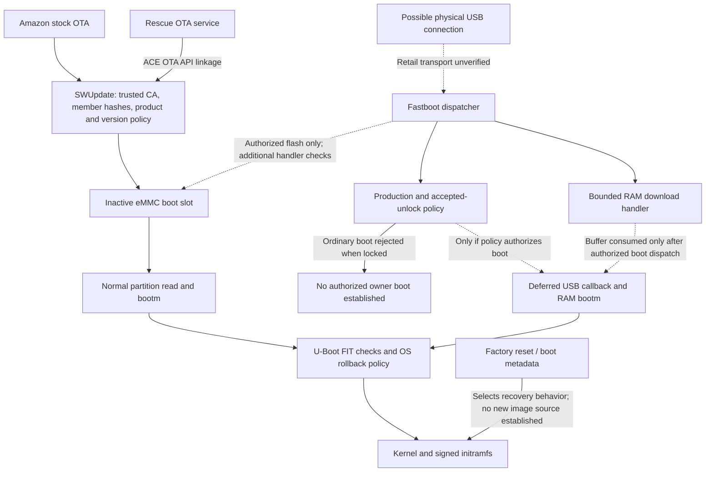
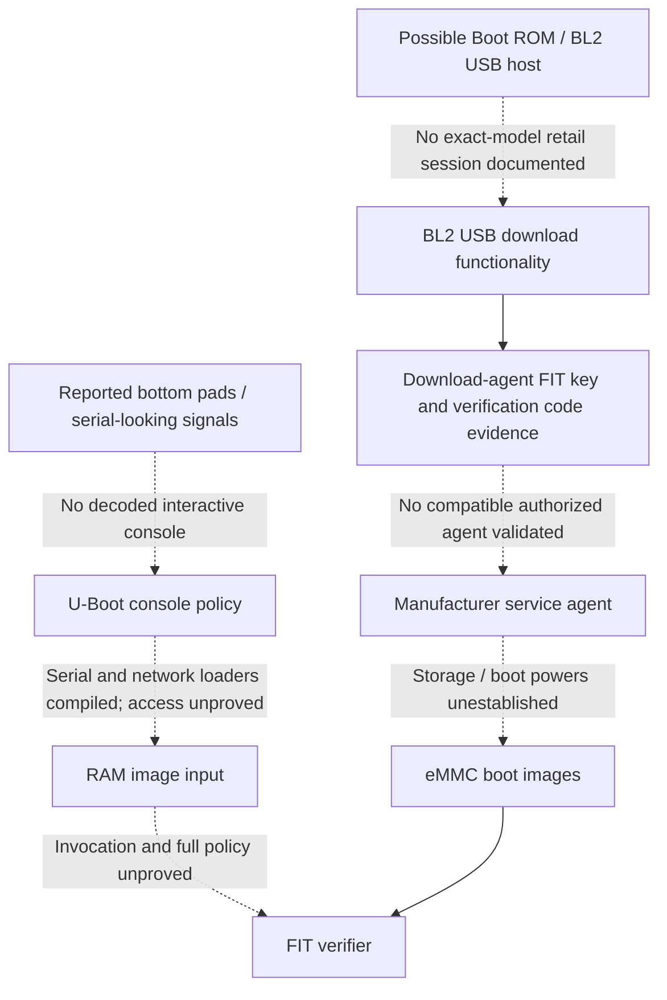

# Echo Show 5 Gen 3 — Boot Access and Execution Feasibility

12 November 2026. Target: H97N6S / `hypnos` / MediaTek MT8169. Continuation of the preserved firmware investigation, principally build `7202000017420`. Scope: public documentation, original firmware, and non-invasive offline analysis. No firmware executable was run, device contacted, authorization state changed, or modified image constructed.

## Conclusion

**No currently documented route was established that lets a retail owner submit their own boot image to this locked device's FIT verifier or obtain persistent native custom-software execution.** This is a bounded finding from the reviewed sources and firmware, not proof that no private service process or undiscovered method exists.

There is an evidenced vendor-authorized delivery route: normal OTA installs authenticated stock boot images to an inactive slot, which the normal eMMC boot path later loads. That is different from an owner-selectable boot-image interface. Public Amazon documentation describes checking for software updates, not selecting a local boot image [P1].

**An important earlier inference is corrected:** an acknowledgement-only fastboot `boot` handler does not mean RAM boot is absent. This pass traced a deferred USB completion callback and an actual `bootm` path in the inspected binary. The locked-production filter rejects ordinary `boot` before that callback is selected. Transport, authorization, verification and persistence remain separate barriers.

The FIT issue remains a strong code-level applicability finding, not demonstrated arbitrary-code execution. Neither a bootloader unlock nor a custom-image boot on retail hardware has been reproduced.

## What this continuation adds

- Reconstructed the normal eMMC load commands and their connection to `bootm`.
- Extended fastboot analysis beyond command handlers to the USB completion callback; corrected the earlier RAM-boot interpretation.
- Recovered the production-dependent command filter's prefix tables and distinguished RAM download from permission to boot or write storage.
- Inspected additional recovery, Rescue OTA, developer-tool and package-authorization artifacts. Found no `recovery_ota.sh` in the enumerated initramfs or system image despite the recovery dispatcher referencing it.
- Checked exact-model pad reports, later comments, regulatory photographs and public project support. No verified exact-model pinout, USB enumeration transcript, permitted custom boot, or public manufacturer unlock issuance workflow was found.
- Mapped persistence controls and evidence gaps without revisiting completed cryptographic checks or application porting.

Previous firmware inputs, scripts, reports and cryptographic results were retained. New analysis lives under `echo_boot_access/`; prior evidence remains under `echo_research/`. The earlier research ZIP is unchanged. This report and its continuation evidence archive supplement it.

## Evidence conventions and limits

**Static** means visible in original source/configuration, data or decoded instructions. **Cryptographic baseline** refers to the completed original-image checks, not a new acceptance test. **Reported** means a device owner's public observation. **Inferred** means a proposed relationship that has not been demonstrated end to end. **Unknown** means the evidence needed to decide is missing.

This is a complete inventory of mechanisms identified in the reviewed material, not a claim to have exhaustively ruled out every hidden interface or audited all firmware. Production hardware availability requires exact-model observations or documentation; compiled capability alone does not establish it. The renewed CVE review is a separate desk-review pass against upstream source, not external peer review.

## 1. Boot-image delivery and authorization map

Solid edges describe established implementation/configuration relationships; dashed edges indicate an unverified transport, service workflow or downstream operation. Static edges are not hardware-observed execution traces.

Early service and console paths are separate from ordinary OTA and fastboot:

The first ROM stage is not present in the OTA and its USB policy was not measured. BL2 authenticating downstream firmware and U-Boot authenticating Linux are distinct trust boundaries. Developer VDA/VSH/VPM is a third, userspace authorization plane; it is not an alternate arrow around these gates.

## 2. Interface evidence table

| Mechanism / input origin | Processor and destination | Signature / authorization boundary | Production availability and evidence | Finding |
|---|---|---|---|---|
| Normal eMMC boot | Compiled `boot_rd_img` reads the selected partition into RAM; `mtk_boot` calls `bootm` | Trusted-key FIT configuration/payload checks; OS rollback services | Static environment and loader code; exact live environment/slot unmeasured | Established normal image-consumption path, not permission to replace the partition |
| Cloud or Settings-initiated stock update | `ace_otad`, SWUpdate wrapper and raw partition handlers; inactive slot | Configured OTA CA, signed description/member digests, product identity and version/timestamp policy; FIT checks on subsequent boot | Official update UI documentation [P1]; extracted service/configuration; preserved CMS validation | Authorized stock delivery exists. No public local custom-image selection procedure found |
| Rescue OTA | Failure-manager file watcher invokes `rescueOTAservice`; private library imports ACE OTA API | Existing OTA service linkage; no separate signature-free installer established | Packaged path/service and ELF symbols; live trigger state unmeasured | Recovery orchestration lead, not an established owner image importer |
| Initramfs OTA recovery | Boot metadata mode `2` dispatches `/etc/init.d/recovery_ota.sh` | Preceded by boot FIT checks; downstream installer policy unknown because the referenced script is absent | Dispatcher present; script absent from both enumerated images | Incomplete/stale/externally supplied path remains possible. No usable OTA-recovery import workflow established |
| Factory reset / rescue UI | Boot metadata mode `1`, factory-reset scripts and userdata cleanup | Runs from authenticated boot components; allowlist/reset policy | Script and userdata format table present; public reset reports | Reset is not bootloader unlocking or a new boot-image source |
| Fastboot RAM download | U-Boot download handler receives bounded data into its configured buffer | The reconstructed initial prefix filter does not list `download` as restricted; transport/session and subsequent checks still apply | Handler and USB callback code compiled; screen reported, transport not demonstrated | RAM staging is plausible conditionally. Staging alone does not invoke FIT verification |
| Fastboot RAM boot | Successful `boot` dispatch installs a USB completion callback; callback invokes `bootm` | Initial production/accepted-unlock command filter, then FIT and rollback paths | Entire static callback-to-loader connection now found; ordinary `boot` rejected in locked-production policy | Compiled path exists. No documented owner authorization or live retail acceptance |
| Fastboot storage flash/erase | Dispatch to storage handlers | Restricted classes; special certificate/code handlers and conditional exception state | Static tables and handlers; full target-dependent permission matrix incomplete | No public unrestricted production flashing route established |
| Manufacturer unlock material | Special fastboot inputs, signed unlock/one-time records | Certificate chain, signature and payload validation; distinct persistent and one-time mechanisms | Code and diagnostics; no public H97N6S issuance/enrollment workflow found | Infrastructure exists, but owners cannot infer eligibility or signing authority |
| BL2 USB download agent | Early USB download code receives/verifies an agent | Embedded `key-da`; signature and region-check diagnostics | Static keys/code strings only; no validated authorized agent/session | USB capability is more than a connector guess, but not a usable retail service route |
| Boot ROM USB recovery | Immutable ROM, before BL2 | Exact MT8169 product fuse/authentication policy unknown | Related chipset tooling is background only | No exact-model authorized recovery procedure established |
| UART console / serial file input | Possible bootloader console; S-record/Kermit/XMODEM/YMODEM-related loaders compiled | UART-disable policy and command-dispatch restrictions; subsequent boot policy | Kernel/recovery console configuration and community measurements; no usable console | Do not equate a TX signal with a shell or permission to load/boot |
| Network or USB-storage U-Boot loaders | TFTP/BOOTP and USB host/download-related code/data | Console/command availability, board routing/network support and boot verification | Generic compiled command descriptions only | No automatic production network/removable-media boot route established |
| VDA transport, VSH shells, VPM packages | Linux developer daemon, shell/component tooling and package manager | Enable marker, developer state, client authorization and package trust/lifecycle policy | Actual files installed; official enrollment documentation covers Fire TV, not this Show [P2] | Application development access would still differ from raw partition/root/bootloader authority |
| Factory/provisioning tools | `factorytest`, `provisionerd` and manufacturer-oriented components | Privileged execution/service policy; full workflow not reconstructed | Packaged executable presence only | No published owner service kit, signed agent or entitlement demonstrated |

## 3. Fastboot correction and reproducible static evidence

### Deferred boot was missed previously

The previous report correctly observed that `boot`, `continue` and ordinary `reboot` share the small acknowledgement routine at `0x41e3c870`. Its conclusion that this meant the inspected firmware had no RAM-boot workflow was incorrect. Upstream U-Boot v2020.10 separates acknowledgement from USB completion actions [P3, P4]. This binary retains that separation:

1. USB command receiver at `0x41e5160c` calls the dispatcher at `0x41e5167c`.
2. After an `OKAY` response, command index `4` (the `boot` table entry) selects callback `0x41e512f4`, through the branch at `0x41e51764` and callback store at `0x41e51778`.
3. That callback calls `0x41e3bd60` at `0x41e51300`.
4. The routine reads `fastboot_bootcmd`; its fallback formats the downloaded buffer's address and invokes the `bootm` entry at `0x41e13ab8` through `0x41e3bddc`. The argument table names `bootm`.
5. The `bootm` entry connects to the previously inspected loader at `0x41e20374`, including a direct branch at `0x41e13bdc`. The existing FIT-verifier call path therefore has a compiled RAM-boot connection, conditional on successful command authorization and dispatch.

Evidence: `echo_boot_access/fastboot-policy-disassembly.txt`, generated by `trace_delivery.py`; upstream reference files `upstream-f-fastboot.c` and `upstream-fb-command.c`. No request was sent to a device and no downloaded image was tested.

### The production gate remains

The dispatcher calls its restriction predicate before ordinary command lookup. The underlying function at `0x41e029e4` checks a production-and-not-accepted-unlock predicate through `0x41e4ab38`. That predicate calls the production-status helper and the accepted-unlock checker. A production-status read error assumes production. This conclusion uses code, not the message text alone.

Recovered prefix tables:

| Table | Data offset in extracted U-Boot payload | Contents / interpretation |
|---|---|---|
| Initial exceptions | `0x828c8` | Relock/flag operations and three signed unlock-material inputs. Passing this filter does not make their handler's certificate or payload validation optional |
| Restricted classes | `0x7d6f0` | `verify`, `dump`, `erase`, `boot`, `env`, `signature`, `oem`, `flash` |
| State-dependent extra exceptions | `0x7d3b8` | Flash/erase and manufacturing-oriented OEM operations; enabling state is not established as owner-available |

The target-specific extra restriction-list provider at `0x41e029dc` branches to a routine returning an empty list in the inspected code. This is not a claim that all other state-dependent checks have been eliminated from every handler. Full table values and dispatch addresses are preserved in `fastboot-policy-tables.json`.

**Result:** the filter supports conditional acceptance of a bounded RAM download but rejects ordinary `boot` for locked production under the reconstructed policy. A display saying FASTBOOT does not prove a protocol session, and a session accepting a download would not prove permission to boot it. The corrected obstacle is authorization and transport, not missing compiled RAM-boot machinery.

### Normal storage origin

Compiled environment strings at payload offsets `0x8d7bc`, `0x8d8d9` and `0x8d944` describe: select eMMC device, resolve the selected boot partition, read it into `loadaddr`, inspect the image, then call `bootm` using `loadcfg`. These are direct evidence of the intended storage-to-verifier path. Persisted environment, runtime partition selection and provisioning may differ; no owner-controllable environment write route was established.

## 4. Recovery and manufacturer-service boundaries

`echo_research/ramdisk/etc/init.d/recovery_init.sh` reads boot metadata from the misc-device abstraction. It dispatches factory-reset mode to the present reset script and OTA mode to the absent `recovery_ota.sh`. The initramfs `init` invokes its recovery init without mounting system/vendor in OTA mode. Consequently, it is especially unsafe to assume that an installer in those filesystems silently completes this path.

Possible explanations are a legacy/unexercised mode, another build or separately provisioned component, or runtime assembly not represented by the packaged image. No one explanation is confirmed. The absence result is bounded to the supplied images and extraction inventories; it is not proof that every retail recovery mode is nonfunctional.

The separate system-rootfs Rescue OTA path watches `/var/lib/failure-manager/force-ota-check`. Its library exports `startOtaWithRetry()` and imports `aceOta_start`; service configuration uses a dynamic identity and confinement. This supports OTA orchestration rather than a demonstrated independent raw-image writer. An exhaustive call/dataflow audit of its OTA API implementation was not completed, so identical policy in every downstream case is not asserted.

BL2 contains `USB CDC ACM for preloader`, download-agent receipt diagnostics, signature success/failure diagnostics and kernel/FDT-region check diagnostics, plus its separate public `key-da`. These indicate authenticated agent handling is a serious boundary to investigate. A string saying a target download-key check is unimplemented does not establish disabled agent authentication; it may refer to a mode-selection hook rather than cryptographic authorization. No publicly validated hypnos service agent, complete ROM/BL2 download session, factory signing entitlement or owner service enrollment was found.

## 5. Physical interface evidence

The original exact-model post reports a fastboot screen and a bottom 3×3 contact grid labeled J4. Its follow-up supplies board photographs. Later commenters identify a differential-looking trace pair and propose USB, but do not supply a reproducible enumeration log or validated protocol/pinout [P5, P6]. J4 is a connector reference designator, not a JTAG designation.

An additional owner reports serial-looking activity, including an attempted 115.2-kbaud decode and a “looks encrypted” interpretation. That is not proof of encryption: wrong framing/rate, another protocol or non-console traffic remain competing explanations. The later dedicated serial post says decoding did not produce much [P6, P7]. Neither supplies a proven interactive login.

Regulatory internal photographs explicitly label H97N6S. Sampled photographs show boards and exposed contact areas, but not a usable net-labeled pinout. The PDF reached through the `2A4DH-1022` directory internally says `2A4DH-1021`; this discrepancy remains unresolved. It cannot identify every retail board revision conclusively [P8]. The listing contains schematics and a revised schematic as **metadata-only** entries, rather than publicly downloadable schematics [P9]. A confidentiality request is listed. Public availability of photographs does not imply schematic availability.

The public TechInsights exact-model teardown summary corroborates a real H97N6S teardown, but does not publish a service pinout or unlock in the reviewed summary; its paid report was not accessed [P10]. No connector assignment is inferred solely from shape, voltage or trace appearance. No physical probing was performed.

## 6. Developer versus bootloader authorization

Amazon's reviewed developer-mode documentation describes authenticated Fire TV enrollment, VDA transport, VSH shell access and VPM package operations. It describes constrained shell/file access and limits sideloading to non-Amazon packages [P2]. It does not publish an H97N6S enrollment flow or authorize bootloader unlocking. API references mentioning Echo product identities do not establish enrollment support.

The inspected Show image contains real developer infrastructure:

- VDA startup and developer-mode startup units require `/etc/vda/enable-vda`, absent from the packaged system image. Runtime overlays/provisioning are unmeasured.
- `vdad-gadget-setup` configures a Linux FunctionFS USB gadget. This is a concrete userspace USB implementation, not proof of connector routing, startup or retail enablement. Its `adb` naming does not establish an unrestricted Android debug interface.
- The daemon contains client-key authorization, developer-state and production-root-restriction diagnostics. Their complete enforcing control flow was not reconstructed in this pass. It also contains “authentication not required” strings; without branch context these do not establish a production exception.
- A watcher service calls developer-mode management after a privileged runtime marker changes. The presence of that service does not give an unprivileged owner permission to create its marker or change device state.
- Package-manager configuration sets `allow-unsigned = false`, defines signing authorities and enables startup validation. Debug certificate paths and developer database/vendor/CRL interfaces do not confer a signing entitlement. The complete state-dependent package validation implementation remains unaudited.

These are different authorities:

| Authorization | Possible scope if legitimately granted | What it does not establish |
|---|---|---|
| Developer app enrollment | Install/launch permitted developer packages and use restricted development tools | Root, raw eMMC access, arbitrary boot images or bootloader-unlock certificates |
| VDA client approval | Authenticate a host connection in an enabled device context | Eligibility for developer enrollment or authority to flash firmware |
| Manufacturer persistent unlock | Change the accepted boot policy if a valid device/payload-bound signed record is approved | Public availability, unrestricted signing keys, or exact behavior across every reset/update |
| Manufacturer one-time unlock | Temporary authorization represented by separate code/certificate machinery | A permanent unlock or persistence after reboot |
| OTA signing | Authorize an entire update and its declared members | A credential an ordinary developer account automatically receives |

No public exact-model application-enrollment or bootloader-unlock issuance workflow was established. These are missing evidence items, not assertions that Amazon has no internal workflows. No account enrollment, credential request or state change was attempted.

## 7. Independent desk assessment of CVE applicability

The upstream fix rebuilds signature coverage from the configuration's image references rather than trusting the unsigned supplied node list [P11]. The original hypnos routine instead reads `hashed-nodes`, parses its path strings and passes that list to region construction. Selected-configuration membership checks are present but do not implement the upstream replacement rule. The completed original-image verification results and caller disassembly support that interpretation.

Unsigned `hashed-nodes` alone is not the defect: current upstream documentation still treats it as a signing record, while verification recomputes the required coverage [P12]. The signed configuration's image references, rollback field and payload-hash metadata are not generally unauthenticated; all seven original payload digests matched. Extracting a public verification key supplies no signing authority.

| Proposition | Assessment |
|---|---|
| This binary retains the old coverage-selection behavior | Strong static evidence; not merely a version-string match |
| A compiled kernel-loading path reaches it | Established earlier; this pass additionally connected the deferred RAM-boot callback to the loader |
| Original signatures validate using the reconstructed region calculation | Preserved baseline: eight boot configurations and three early-stage FIT configurations |
| Every retail H97N6S runs this exact component/state | Unverified; four manifests declare the same boot components, not all devices/builds |
| A malformed/altered FIT will pass all checks | Untested and not established |
| The weakness itself grants an image-delivery interface | Incorrect; delivery and dispatch authorization occur separately |
| Successful kernel-image execution would permanently unlock BL2/U-Boot/fuses | Not established; later-stage control is not a rewrite of earlier trust anchors |

For production impact, all of the following would have to hold: the affected bytes are deployed; a policy-permitted route supplies the relevant input; selection and validation reach the old routine; no other format/hash/signature/rollback check rejects it; the selected components can execute; and any desired persistence has an independently authorized storage/lifecycle route. No altered-image experiment was performed to decide these conditions.

Compensating boundaries include OTA manifest/member authentication before storage installation, locked fastboot command filtering, authenticated unlock material, BL2 downstream trust, format/type/hash checks, trusted-world OS rollback decisions, and filesystem/package/service policy after kernel startup. They act at different stages. Their existence does not repair the old verifier, and the old verifier does not automatically defeat them.

## 8. Persistence and lifecycle barriers

| Control | Confirmed evidence | Effect on a legitimately authorized custom deployment / unknown |
|---|---|---|
| A/B installation | Signed description lists `uboot_a/b`, `boot_a/b`, `system_a/b`, `vendor_a/b`, `tee_a/b`, `sspm_a/b`, `spmfw_a/b` | Installation must target the correct inactive slot and its matching components. Exact GPT offsets, live selection, success counters and fallback decisions require runtime/source evidence |
| Shared early loader | Both update selections write BL2 to `/dev/mmcblk0boot0` | An A/B boot update is not a complete duplicate of the earliest mutable trust stage. Recovery assumptions must account for the shared target |
| Update selection | `09-swupdate-args` selects copy B when slot A is active, otherwise copy A; supplies product identity | A change confined to one slot may cease to run after a legitimate switch/update. No owner-controlled selector was established |
| Update version checks | Signed manifest compares image version and timestamp with installed release metadata | Stock updater does not provide an arbitrary downgrade mechanism. These checks differ from hardware/trusted-world rollback floors |
| FIT and early trust | Preserved configuration signatures, compiled keys and BL2 key relationships | An authorized userspace app does not acquire authority to replace the boot chain |
| OS rollback | Compiled rollback-version reads, trusted-execution requests and failure paths | Custom firmware would need to meet the actual authorized rollback policy; stored floor and secure-world details remain unknown |
| Filesystem integrity | Signed root-hash evidence and initramfs verity setup; production-dependent boot arguments | Expected locked-production verity-on policy is static, not measured. The initramfs default alone does not establish retail state |
| Read-only system and writable data | Normal-mode root/vendor mounts are read-only; userdata backs `/var`, `/home` and board-specific `/data`; full-root writable overlay is a separate branch | Writable storage is not permission to install startup services or execute a trusted package. Actual ownership/Smack and package lifecycle matter |
| Package/startup trust | `allow-unsigned = false`, configured authorities, startup validation | Legitimate app deployment needs the correct enrollment/signing and lifecycle authority, even without replacing the OS |
| Factory reset | Recovery format table includes userdata; reset code backs up/restores only allowlisted data for selected reset types | Persistence in writable data may be removed. Survival across all reset types cannot be assumed |
| Routine OTA replacement | Manifest installs new boot/system/vendor and other components | Temporary execution or changes to a single image do not imply persistence across updates. Complete update success/fallback bookkeeping was not reconstructed |

A persistent app, a privileged service, a custom kernel and a permanently unlocked boot chain are four different outcomes. None has been demonstrated here. Persistence needs an authorized placement, startup, integrity and update/reset story; a successful one-time boot alone would not supply those.

## 9. Exact-model public discoveries and search limits

Searches covered `hypnos`, H97N6S, MT8169, fastboot, boot images, recovery, developer enrollment, service manuals and pinouts. Sources included upstream U-Boot, Amazon documentation/community, GitHub project documentation, regulatory exhibits and original hardware-research posts. Related devices and generic MTK support were not counted as exact-model success.

Reviewed amonet and TECHO5 support remains centered on named older targets; LibreEcho's published supported models do not include this Show [P13–P15]. Public board databases corroborate identities but do not constitute unlock demonstrations. A displayed fastboot screen, differential-pair hypothesis, network service-name guess, or a different Echo Spot/Dot result is insufficient evidence of a reproducible hypnos execution route.

No new exact-model authorized image importer, public service-agent release, enrollable native developer workflow, bootloader-unlock token service, or demonstrated booting custom image was verified. This is a search result, not a universal proof of absence. No private forums, paywalled teardown internals or Amazon internal materials were accessed.

## 10. Unresolved blockers, in priority order

1. **Public owner authorization:** neither native developer enrollment nor bootloader/service credential eligibility is documented for H97N6S in reviewed sources.
2. **Exact-model transport:** no validated bottom-grid net assignment, USB enumeration/protocol transcript or decoded interactive UART session.
3. **Permitted dispatch:** a bounded download is distinct from authorization to invoke boot or write eMMC; the default production gate blocks ordinary boot.
4. **Complete policy review:** format checks, key selection, every handler state, BL2 agent authentication and trusted-world rollback enforcement remain incompletely audited.
5. **Deployment identity:** exact installed bootloader hash, board revision, live security state, slot and environment are unmeasured.
6. **Persistence lifecycle:** slot-success/fallback metadata, reset survivability and package/startup authorization require exact implementation and runtime evidence.

### Three highest-value next research tasks

| Rank | Task | Concrete evidence needed / success criterion |
|---|---|---|
| 1 | Resolve exact-model owner/manufacturer authorization through published material or an owner-submitted vendor support inquiry | A model-specific Amazon statement or documented process identifying eligibility, allowed operations and whether it grants app enrollment, service recovery or bootloader unlock. A generic Fire TV account flow is insufficient. No message was sent during this investigation |
| 2 | Obtain matching hypnos source and independently review the delivery-policy findings | Build-correlated U-Boot/BL2 source/configuration, plus a reviewed address-to-source mapping for the production gate, USB callback, agent verifier and rollback calls. Success is a reproducible policy matrix and corrected call graph, not an exploit |
| 3 | Locate an existing non-invasive exact-model hardware observation package | Board/revision identification, original firmware identity where available, validated connector/net documentation and a passive enumeration or boot-log capture from an authorized owner/service workflow. Success is proof of a transport and its stated permissions; a fastboot photograph or pad hypothesis is insufficient |

Within the current no-device scope, source retrieval, policy review and locating already published observations can continue. Establishing actual pin functions, runtime state or successful custom execution requires evidence that is not present in the public firmware alone. No additional application-porting work is proposed here.

## Artifact references and reproducibility

Prior authoritative report: `Echo_Show_5_Gen3_Feasibility.md`, version 3; prior archive: `Echo_Show_5_Gen3_Research.zip`. Those remain unchanged by this continuation. The fastboot inference corrected above is preserved there as historical work, not silently rewritten.

| Artifact | Use |
|---|---|
| `echo_research/u-boot-mtk.bin` | Original outer U-Boot FIT, SHA-256 `157ef8534d4fbfcf85bd7c72c7c9ae7447e42086b3259fc5356c02af23ffcc93` |
| `echo_research/u-boot-mtk_images_kernel-1.bin` | Disassembled AArch64 payload, linked at `0x41e00000`; SHA-256 `6118b031654ed34ee7a27703b60e920c6df99155fe7235ecc86d3e5d047ffda9` |
| `echo_research/original-fit-signature-checks.json`, `boot-chain-signature-checks.json`, `verification-boundaries.json` | Completed original-signature and coverage checks; retained, not rerun as new work |
| `echo_research/manifest-trust-checks.json`, `comparison-summary.json`, `sw-description` | OTA trust baseline, cross-build declarations and A/B targets |
| `echo_research/ramdisk/init`, `etc/init.d/recovery_init.sh`, `etc/init.d/factory_reset.sh`, `etc/factory-reset-config/frtab` | Recovery dispatch, read-only/data overlays and reset lifecycle |
| `echo_boot_access/trace_delivery.py`, `fastboot-policy-disassembly.txt`, `fastboot-policy-tables.json` | New static callback/policy reconstruction; no input mutation or execution |
| `echo_boot_access/inspect_delivery.py`, `system-policy-inventory.json`, `system-policy/`, `binary-strings/` | New targeted extraction, original-file fingerprints, service/configuration evidence and ELF symbol inventories |
| `echo_boot_access/bl2.img.strings.json` | Offset-indexed early download/security diagnostics; leads, not proof of live policy |
| `echo_boot_access/ERRATA.md` | Explicit correction of the earlier fastboot interpretation |

The scripts only read existing firmware and write analysis outputs in the new directory. `trace_delivery.py` reproduces the selected disassembly and table extraction; `inspect_delivery.py` requires the existing decompressed system image and the previously used Python Squashfs/LZ4 dependencies. It does not re-download or execute the image. Strings and automatic annotation are not a formal control-flow proof. Large original filesystem images remain in the existing work artifacts, with their provenance/fingerprints in the prior archive; they are not duplicated in the continuation archive.

## Primary sources

- **P1 — Amazon screen-device update workflow:** https://digprjsurvey.amazon.com/csad/help/node/GYB55PBLWG8A6FJ8
- **P2 — Amazon developer-mode scope and authorization:** https://developer.amazon.com/docs/vega/2.0/developer-mode
- **P3 — Upstream v2020.10 fastboot command handling:** https://github.com/u-boot/u-boot/blob/v2020.10/drivers/fastboot/fb_command.c
- **P4 — Upstream v2020.10 USB completion callbacks:** https://github.com/u-boot/u-boot/blob/v2020.10/drivers/usb/gadget/f_fastboot.c
- **P5 — Original exact-model fastboot/contact-grid report:** https://www.reddit.com/r/hacking/comments/1d01lf4/alexa_echo_show_5_3rd_gen_jailbreak_press_all/
- **P6 — Original board photographs and later USB/serial comments:** https://www.reddit.com/r/hacking/comments/1d0jysx/update_alexa_echo_show_5_gen_3_jailbreak/
- **P7 — Separate exact-model serial report:** https://www.reddit.com/r/hacking/comments/1g9zi04/echo_show_5_3rd_gen_serial_data/
- **P8 — Regulatory internal-photo exhibit:** https://fccid.io/2A4DH-1022/Internal-Photos/IntPho-6499216.pdf — internal FCC-ID discrepancy retained above.
- **P9 — Regulatory exhibit availability listing:** https://fccid.io/2A4DH-1022 — public mirror of applicant exhibits; schematics metadata is not schematic content.
- **P10 — Exact-model teardown public summary:** https://www.techinsights.com/ja/node/54653
- **P11 — Primary upstream fix:** https://github.com/u-boot/u-boot/commit/2092322b31cc8b1f8c9e2e238d1043ae0637b241
- **P12 — Primary FIT verification documentation:** https://docs.u-boot.org/en/latest/usage/fit/signature.html
- **P13 — amonet project:** https://github.com/R0rt1z2/amonet
- **P14 — TECHO5 project:** https://github.com/HuskerMinion/techo5
- **P15 — LibreEcho supported devices:** https://libreecho.org/
- **Firmware provenance:** https://ftvdb.com/echo/firmware/com.amazon.hypnos.kepler.os/ ; original public OTA https://d1s31zyz7dcc2d.cloudfront.net/2026/11/5/b3920a21-ac8f-45b0-a64f-f6e42d190151/amzn-image-swupdate-hypnos.swu

Public sources were reviewed on 12 November 2026. The archive includes the retrieved upstream reference files and exact local evidence; mutable project pages do not establish support for an unlisted device.