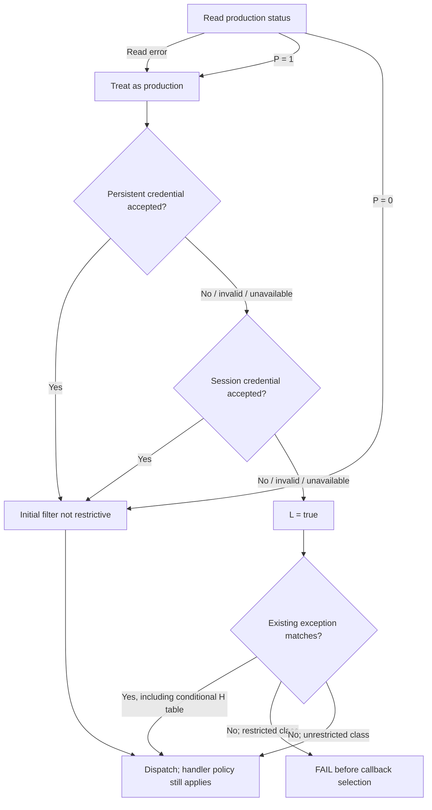

# Echo Show 5 Gen 3 — Locked Boot Policy and Non-Invasive Access

12 November 2026. H97N6S / hypnos / MT8169. Continuation of **Boot Access and Execution Feasibility**, using the same original firmware snapshot, catalog build `7202000017420`. Earlier reports, archives and corrections remain preserved. New work is under `echo_locked_policy/`.

## Finding and practical effect

**No new evidence establishes a documented owner-controlled custom boot or native application-enrollment route on a locked retail unit.** The analysis now explains the principal boot restriction more precisely: a production predicate, combined with the absence of an accepted persistent or session unlock, activates a command-prefix filter. Ordinary fastboot `boot` is denied before its deferred USB completion callback is selected.

This pass materially improves the **policy model**, not the demonstrated feasibility of custom execution. It identifies a prior-stage special flash/erase exception state, separates persistent from one-time credentials, confirms downstream handler restrictions, and qualifies earlier claims about universal FIT verification. None supplies owner authorization, an electrically validated connection or a working jailbreak.

The requested non-invasive constraint is decisive: no reviewed source provides a verified H97N6S J4-to-host adapter, published electrical pinout or successful USB enumeration evidence. Generic pogo fixtures, power adapters and a charging stand are not demonstrated data connections.

No device was contacted or modified. No signed image was altered, firmware executed, authorization changed, exploit input generated or credentials forged. Completed signature checks and firmware extraction were not repeated. The command matrix below is a manually reconstructed static model, not a firmware emulator or hardware test.

## 1. Authorization state and return-value model

All addresses refer to the original extracted AArch64 U-Boot payload linked at `0x41e00000`, SHA-256 `6118b031654ed34ee7a27703b60e920c6df99155fe7235ecc86d3e5d047ffda9`.

| Symbol used here | Recovered function / source | Confirmed static meaning | Unmeasured or incomplete |
|---|---|---|---|
| P: production | `0x41e4a99c` calls `0x41e13118` with index `0x13` | Successful read: nonzero byte becomes true. Error: returns true and reports assuming production | Actual retail value and provenance of the runtime data |
| S: secure boot | `0x41e4a948`, reader index `0x4b` | Separate boolean; read error assumes secure | Hardware fuse state and exact early-stage enforcement |
| Uₚ: persistent accepted unlock | `0x41e0f280` | Reads IDME `unlock_code`; verifies it at `0x41e0eeb0`; verifier result zero becomes true. Read/validation failure does not grant this state | Token issuance, persistence across every reset/update, complete cryptographic-library audit |
| Uₜ: one-time accepted unlock | `0x41e0f814` | Revalidates session-held signed material through `0x41e0f33c`; zero result becomes true | Exact live session, reset/handoff lifetime and provisioning |
| U: accepted unlock | `0x41e0f308` | Uₚ OR Uₜ; persistent success returns true without needing the second test | No publicly available way for an owner to obtain either credential established |
| L: restricted production | `0x41e4ab38` | P AND NOT U | This is a predicate result, not an independent measured lock bit |
| H: special prior-stage state | `0x41e1262c` | Reads a word from boot-argument memory at `0x440003b0`; exactly `1` enables an extra prefix-exception table | Meaning, trusted producer, eligibility and actual retail value not established; do not label it owner developer mode |

### Where production information comes from

The reader at `0x41e13118` looks up `/efuse` and its `efuse,data` property in the live control FDT, then copies the indexed field using a compiled size table. Thus P and S are read from a **runtime eFuse-data representation**, not directly sensed from silicon by these decision functions. The packaged U-Boot DT contains `/efuse` metadata but no `efuse,data` property. Startup/prior-stage population is a reasonable inference, but its exact producer and hardware correspondence have not been traced end to end. Missing/failed lookup reaches the caller's production-assuming error behavior.

This distinction strengthens the evidence for the intended policy while limiting any claim about actual fuse state. P and S also must not be merged: different indices and separate error paths are visible.

The diagram describes authorization predicates, not instructions for changing state. A production read error does not invalidate a genuinely accepted credential, and does not close all informational commands: “fail closed” here means selecting restrictive production policy rather than treating an error as a development device.

### Persistent and session credentials are different

The persistent verifier parses signed material, obtains its compiled public verification key, validates the signature and compares the authenticated `code` with locally derived device-code data. The setter at `0x41e0f200` validates before storing the record in IDME. It is not a general unprotected boolean toggle. The device-code generator calls the indexed-data helper; its equality check is a device-binding mechanism. No private key was recovered or used.

The one-time verifier uses a certificate-chain-bearing signed structure, a separate compiled root/key source, signature validation and a `nonce` equality check against the current challenge. Its setter at `0x41e0f778` validates before placing signed material in heap-backed session storage. Challenge generation uses random data. No nonvolatile write is visible in that setter. This supports a session-scoped distinction, not an externally verified promise about all warm-reset behavior or the exact moment authorization expires.

Read/parse/allocation/signature/payload-match failures in the inspected decision paths do not set accepted-unlock true. A complete cryptographic/parser audit is outside this pass, so this is not a proof that all malformed inputs are handled correctly.

**Additional lifecycle qualification:** the `oem relock` handler clears the persistent IDME record. It does not visibly clear the separate session token in this handler. Therefore a successful relock response alone should not be represented as proof that every accepted-unlock state is gone immediately. No relock or state change was attempted.

## 2. Fastboot command-permission matrix

The initial predicate at `0x41e029e4` is called before dispatch. Its return value is normalized by `0x41e4ac84`; nonzero means reject. Prefix comparison uses the recovered fixed-length comparison helper. This matrix covers the 15 canonical dispatch entries plus three credential-input forms. It does not generate alternate, malformed or bypass commands.

**Pass** means only that this filter does not reject the canonical command. It does not mean successful execution or permission to alter arbitrary state. **Reject** prevents ordinary dispatch and therefore prevents the boot callback. Unknown states are explicitly bounded below.

| Canonical operation | Locked production, H ≠ 1 | Locked production, H = 1 | Accepted persistent OR session unlock | Non-production | Handler / remaining condition |
|---|---|---|---|---|---|
| `getvar` | Pass | Pass | Pass | Pass | Variable support, runtime data and any environment-backed response still matter |
| `download` | Pass | Pass | Pass | Pass | Nonzero declared size and configured-buffer limit; no automatic boot or storage write |
| `boot` | **Reject** | **Reject** | Pass | Pass | Successful dispatch and OKAY response select deferred RAM-boot callback; verification still follows |
| `continue` | Pass | Pass | Pass | Pass | Callback detaches fastboot; not a downloaded-image boot operation |
| `reboot` | Pass | Pass | Pass | Pass | Deferred reset callback, not shared acknowledgement routine alone |
| `reboot-bootloader` | Pass | Pass | Pass | Pass | Handler must successfully set boot metadata before OKAY/reset |
| `reboot-fastboot` | Pass | Pass | Pass | Pass | Boot-metadata update can fail |
| `reboot-recovery` | Pass | Pass | Pass | Pass | Boot-metadata update can fail; no unsigned installer thereby established |
| `set_active` | Pass | Pass | Pass | Pass | Slot metadata handler present; this is a **state-changing** operation, not a read-only observation |
| `flash` ordinary target | **Reject** | Pass | Pass | Pass | Special-state exception is not owner availability; storage target, device, size/format and write errors remain |
| `erase` ordinary target | **Reject** | Pass | Pass | Pass | Device/partition/storage checks remain; destructive, not an observation |
| `oem get_boot_part` | **Reject** | **Reject** | Pass | Pass | Storage-dependent query despite initial OEM-class restriction |
| `oem idme` | **Reject** | **Reject** | Pass | Pass | Handler independently checks L and rejects restricted production |
| `oem flags` | Pass | Pass | Pass | Pass | Handler permits informational behavior but restricts modifying forms in L state; a narrow H-dependent exception also exists |
| `oem relock` | Pass | Pass | Pass | Pass | IDME write can fail; does not visibly clear all session state |
| Signed persistent-unlock input | Pass | Pass | Pass | Pass | Signature, local code binding, size and IDME storage validation |
| Signed one-time-code input | Pass | Pass | Pass | Pass | Chain/signature/nonce validation, session storage and allocation |
| One-time-certificate-named input | Pass | Pass | Pass | Pass | Exception string exists; a complete dedicated accepting handler/workflow was **not** established |

The special H table includes flash/erase and two manufacturing-oriented OEM prefixes. Those extra OEM strings are not among the 15 recovered ordinary dispatch entries, so a filter exception must not be promoted to a working command. Similarly, the conventional Android-style unlock workflow was not established by the presence of Amazon's separate signed-record operations.

| State not directly observable from these artifacts | Matrix interpretation |
|---|---|
| Production status read error, no accepted credential | Same initial filter as locked production; H still needs its own value |
| Invalid/unavailable persistent credential and invalid/unavailable session credential | U is not granted; production restriction remains |
| Persistent invalid but session valid | U is true via the session credential; “persistent failure” alone does not mean locked |
| H unknown on a locked unit | Ordinary boot remains rejected in both modeled H cases; flash/erase availability is unknown rather than universally denied |
| P unknown on an unobserved retail unit | Expected production policy is plausible, but compiled code cannot attest the device's actual state |
| Unknown runtime environment or additional handler conditions | Initial-filter results remain distinct from end-to-end outcomes |

Evidence: `command-filter.txt`, `production-policy.txt`, `flash-state.txt`, `fastboot-handlers.txt`, `flags-full.txt`, `idme-handler.txt`. `policy-model.json` records 108 state/operation combinations. Its Python translation is inspectable and checked for internal consistency; it is not an independent proof of the disassembly or a hardware experiment.

### Separately visible state queries

The recovered getvar dispatch table maps `unlock_status` to U, `prod_locked_status` to L, and `otu_status` to Uₜ. They answer different questions. For example, non-production can have L false while U is false. Runtime variable overrides and lack of transport remain caveats. No queries were sent. The table/handler evidence is saved in `getvar-state-map.json` and `getvar.txt`.

## 3. Verified static RAM-boot trace and post-filter checks

| Step | Static evidence | Meaning / limitation |
|---|---|---|
| USB receive | `0x41e5160c`; transfer-status, length and buffer checks precede dispatcher call at `0x41e5167c` | Requires an actual working USB endpoint/session, not merely a Fastboot screen |
| Initial authorization | Dispatcher `0x41e3cbc8` calls the restriction predicate before command lookup | Rejected boot returns failure; it does not normally obtain successful boot dispatch index |
| Command acknowledgement | `boot` entry index 4 uses shared handler `0x41e3c870` | Small handler alone does not describe execution behavior |
| Callback selection | Receiver requires response prefix OKAY and command index 4; store at `0x41e51778` selects `0x41e512f4` | Both response and command result are checked; not every OKAY response causes boot |
| Completion | `0x41e512f4` calls `0x41e3bd60` | Actual invocation is deferred until the USB completion event; hardware timing/transport untested |
| Runtime hook or fallback | `0x41e3bd60` checks `fastboot_bootcmd`; fallback formats the RAM buffer address and calls `0x41e13ab8` at `0x41e3bddc` | Live hook value was not measured; no owner-controlled hook-setting route established |
| Full bootm fallback | Tail branch `0x41e13bdc` reaches `0x41e20374` with full boot-state mask | This is the confirmed ordinary fallback connection to the Linux/FIT loader |
| FIT format | `0x41e270c4` returns class 2 only after valid FDT header; kernel loader rejects other classes at `0x41e2045c` | Relevant fallback accepts FIT containers; not evidence of ordinary Android boot.img, legacy uImage or raw-zImage acceptance |
| FIT structure | `0x41e299d0`: header/full-tree checks, root description and images node required | Format checks are additional to cryptographic coverage |
| Trust setup | `0x41e0dc90`: production key installed; engineering key added only in non-production or accepted-unlock state | Having either public key does not provide a signing credential |
| Verification dispatch | Configuration-signature and image-hash calls inside `0x41e29bfc` are gated by the verification-state field | Do not claim unconditional verification for every theoretical runtime configuration |
| Rollback | Calls from `0x41e2058c` and `0x41e205a0` check the selected configuration through trusted-execution services and finalize/lock rollback state | Missing version, service errors or denied version fail; exact trusted-world floor remains unknown |
| Remaining boot metadata | Image architecture, type, OS, compression, load/entry and subsequent kernel/ramdisk/DT handling | Presence of checks is confirmed; all combinations and secure-world effects are not exhaustively audited |

### Verification-state qualification

The loader initializes a verification field from the `verify` environment setting through `0x41e523c0`. The decoder returns true for affirmative values, zero for non-affirmative values and `-1` for an absent variable. The downstream branches test zero versus nonzero, so an absent variable takes the checking path. The inspected compiled environment strings did not establish a literal `verify=` or `fastboot_bootcmd=` assignment. Persisted environment and runtime changes were not measured.

This is evidence of conditional verification code—not evidence that an owner can disable it. The production filter restricts the relevant environment/boot command classes, and no authorized owner write path was found. Earlier wording implying unconditional verification in every RAM case is qualified accordingly.

The FIT loader also distinguishes configuration selection from direct subimage selection. The configuration-signature traversal is on the configuration-selected branch; per-image checks occur separately. Therefore it is too broad to say **every caller and selection mode** necessarily traverses the same configuration-verification routine. The normal fallback supplies a buffer address without an explicit subimage selector. Complete alternate-selection policy remains an audit gap; no altered inputs, selector experiments or bypass procedure were constructed.

### RAM versus eMMC

The ordinary eMMC path first reads the selected partition and invokes `bootm` with a board configuration selected by existing environment/board setup. The fallback RAM path uses the download buffer address and does not perform a new eMMC read for that image. Both connect to the same inspected full bootm/FIT loader; there is no demonstrated RAM-specific exemption from rollback or trust setup. Configuration choice, live verification state and the optional runtime hook are the main unresolved differences.

Only the inspected kernel fallback's format claim is made here. Other compiled commands elsewhere in U-Boot do not establish an accessible alternative. A FIT containing the original 32-bit ARM kernel remains the established format baseline; “AArch64 U-Boot” does not imply an ARM64-only payload policy.

## 4. J4 and non-invasive external-access evidence

| Evidence | What it establishes | What it does not establish |
|---|---|---|
| Original exact-model Fastboot/J4 report [S1] | Owner reports a displayed Fastboot state, bottom contact grid and mixed voltages | Calibrated pinout, USB enumeration, known connector orientation or safe host connection |
| Follow-up board photographs and comments [S2] | Real board/contact photographs; a differential-pair hypothesis; later serial-looking observation | USB differential pair confirmed electrically, protocol access or compatible adapter |
| Dedicated serial report [S3] | Two signals looked like TX; decoding was inconclusive | UART console, encrypted data or an interactive login |
| H97N6S regulatory photographs [S4] | Independent board/contact-area imagery | Net-labeled schematic or validation of every retail revision; internal PDF says FCC ID 1021 although URL directory says 1022 |
| Exhibit list [S5] | Schematics are listed as metadata-only; public internal photographs exist | Public access to the actual schematics or service pin assignments |
| Exact-model public teardown summary [S6] | H97N6S teardown exists | Public J4 service pinout or unlock; paid teardown internals were not accessed |
| Amazon CA9TR4 stand documentation [S7] | Exact H97N6S compatibility; USB-C port described as charging output | A USB data/debug connection from the Show to a computer |
| Generic pogo fixtures / other Echo adapters | Mechanical contact methods exist for other products | Electrically verified H97N6S compatibility or protocol support |

The source photograph sets and measurements do not yet justify any J4 pin assignment. The high-voltage observation is not a verified supply specification. Differential-looking traces are a useful lead but cannot distinguish all possible interfaces without electrical/protocol evidence. Serial data decoded at the wrong framing/rate can look unintelligible; encryption remains unproved.

No existing adapter with exact-model pinout, isolation/voltage handling and successful host-enumeration evidence was found. The owner's no-opening/no-solder/no-short constraint therefore leaves **no presently validated J4 connection method**. Removing a bottom cover or adhesive to reveal contacts is not treated as an authorized non-invasive step. No recommendation to connect unknown pads directly to USB is made.

Board-number differences in previous research remain revision questions, not interchangeable wiring evidence. The regulatory exhibit discrepancy also prevents treating one photograph set as conclusive for every unit. No physical device was examined in this pass.

## 5. Manufacturer and developer authorization

The signed manufacturer paths are better characterized now: persistent device-bound signed records and session nonce/certificate authorization feed the accepted-unlock predicate. No exact-model public issuance endpoint, entitlement application or owner service kit was found. An exception allowing signed material to reach its validator is necessary for an authorized service process, but is not proof that retail owners can obtain valid material.

VDA/VSH/VPM remains a separate userspace plane. The existing firmware evidence establishes installed services, enable-marker/state gates, host authorization components and package trust policy. This pass did not repeat extraction or turn those protected files into proposed toggles. Amazon's reviewed enrollment documentation explicitly concerns Fire TV; it does not document H97N6S app enrollment or bootloader unlocking [S8]. No exact-model official process accepting owner-supplied native packages or boot images was located.

| Question | Current answer |
|---|---|
| Can an owner ask Amazon about access? | Yes, a support/developer inquiry is possible; no model-specific published eligibility or successful grant established. No inquiry was sent here |
| Does an Amazon developer account itself unlock this device? | No supporting evidence; the documented Fire TV flow is not transferable proof |
| Is bootloader unlock authorization publicly obtainable for H97N6S? | Not established by the reviewed material |
| Does official recovery accept owner-supplied software? | Not established; authenticated stock OTA remains evidenced, not arbitrary local images |
| Is native developer-package execution supported on this retail model? | Installed infrastructure exists; an owner-enrollable exact-model workflow remains unverified |

The official source-code notice was rechecked. Its accessible rendering still supplied no usable matching hypnos archive link, and the primary page returned HTTP 503 [S9]. No exact-build source release was obtained. Related MT8169 product sources are not treated as matching policy documentation. This leaves binary analysis authoritative for these functions, with source correspondence still needed for an independently reviewed complete implementation audit.

## 6. Corrections, challenged assumptions and residual uncertainty

1. **The deferred RAM-boot correction stands.** Reinspection confirmed the callback and full bootm connection. The original acknowledgement-only inference remains retracted; no new reversal is justified.
2. **“Locked hardware” is a computed policy here.** P and accepted-unlock state determine L; it is not a directly measured single fuse. H comes from a separate prior-stage argument and must not be casually called developer mode.
3. **Flash/erase denial is state-dependent.** Ordinary locked production rejects them, but H = 1 supplies exceptions. This is not proof that a retail owner can select that state. Ordinary boot is rejected in both modeled H cases.
4. **Persistent failure is not necessarily locked.** A valid session token can still satisfy U. Conversely, clearing the persistent record does not visibly clear all session state in that handler.
5. **Filter acceptance is not handler authorization.** Flags and IDME handlers contain their own restrictions; credential setters validate signatures/binding. One certificate-named exception is not a verified complete service command.
6. **FIT checks are not unconditional across every compiled branch.** Verification state, selection mode and the runtime boot-command hook remain explicit conditions. No owner route to manipulate them is established.
7. **Non-invasive transport is still missing.** A Fastboot screen and compiled USB code are not enumeration, a protocol transcript or electrical compatibility.
8. **No new CVE exploitability result.** The old coverage-selection pattern remains established from previous work. No modified-image acceptance, compensating-check bypass or arbitrary execution was tested or demonstrated.

Unknown live values include P/S/H, accepted credential state, exact installed component identity, environment/verification state, USB routing and activation, and secure-world rollback policy. Public package consistency and original-signature validation do not measure these. The matrix reconstructs known code with unknown states shown; it is not advertised as a complete hardware permission matrix.

## 7. Remaining blockers, ranked

| Rank | Blocker | Evidence strength and practical importance |
|---|---|---|
| 1 | No owner-authorized custom boot/app enrollment | No published exact-model workflow established; without it the compiled service infrastructure does not become an owner feature |
| 2 | No validated non-invasive data connection | Exact-model reports stop at display/pad/signal observations; current constraint rules out invasive investigation |
| 3 | Ordinary production boot filter | Strong direct code evidence; rejects boot even under the special H exception state |
| 4 | FIT, rollback and complete downstream policy | Strong evidence of checks, with runtime/selection conditions unresolved; the suspected coverage issue is not proof of acceptance |
| 5 | Exact-build source and independent review | Matching source unavailable; reviewed disassembly/model need outside reproduction, especially data provenance and alternate paths |
| 6 | Persistence and lifecycle authority | A/B, integrity, package/service startup, reset and OTA replacement controls remain; no legitimate arbitrary placement/startup route established |

## 8. Useful non-invasive owner observations

These are optional evidence requests for a future owner, not actions performed here. They need no opening, soldering, shorting, pad wiring, unlock attempt or firmware change.

| Observation | How to collect within normal operation | What it resolves / does not resolve |
|---|---|---|
| Exact model and visible revision markings | Photograph externally readable labels and existing connector area; mask serial/account identifiers before sharing. Do not remove covers/adhesive | Distinguishes model/revision and documents genuinely accessible surfaces; does not identify pad functions |
| Installed software version | Record the existing About/Device Information page without requesting an update or reset | Compares release identity with the inspected package; does not attest bootloader bytes or fuse state |
| Existing menu options | Record visible Settings/About/developer/recovery options as encountered, without enabling modes or changing settings | Tests whether an exact-model enrollment UI is actually exposed; absent menus do not prove absent internal service capability |
| Normal cold-start behavior | Video one ordinary startup using the supplied power connection, without exploratory button combinations | Captures displayed version/mode/errors if any; not a console or protocol trace |
| Fastboot state already encountered | Photograph the existing screen and record how it was reached from memory; avoid trial combinations or reset choices | Corroborates exact-model display behavior; does not establish USB access |
| Ordinary network identity | Read the router's existing client/DHCP entry for the device, if available | Records connectivity/identity without service probing; does not identify VDA or bootloader access |
| Model-specific vendor response | Owner can submit a normal support inquiry asking about native app enrollment, service recovery and bootloader authorization separately | Written eligibility/process/device support would resolve the largest documentation gap; a generic developer-account link would not |

USB enumeration is **not** a presently proposed owner observation: there is no validated data connector/adapter within the allowed setup. If Amazon later supplies a documented exact-model service accessory, its public pinout/electrical specification and permitted read-only diagnostics would need review before any such observation is suggested. `set_active`, reset, flash, erase, credential operations and flag modifications are not observation commands and are excluded.

## 9. Temporary versus persistent execution

A legitimately authorized RAM boot would be temporary execution of the selected boot image. It would not, by itself, replace the eMMC boot chain, change the ROM trust root, grant ongoing manufacturer-signing authority or survive a reboot.

An accepted one-time credential changes this session's policy predicates; its presence does not prove permanent unlock. A persistent signed record is a separate authorization mechanism, but even its name does not establish survival across every reset or update. Durable custom-software installation would additionally need authorized storage/package placement, startup/lifecycle integration, compatible integrity and rollback policy, and a defined update/reset outcome. Those have not been demonstrated.

**Feasibility assessment:** the new evidence improves confidence about what the compiled authorization implementation does. It does not materially improve demonstrated owner feasibility on a locked retail device under the non-invasive constraint. No working custom boot, local custom-package deployment or persistent custom installation was established. The highest-value next evidence is an exact-model authorized workflow/accessory, matching policy source and independent reproduction of the static model—not another repetition of original signature verification.

## Reproducibility and preserved evidence

New tools: `echo_locked_policy/disassemble.py` and `collect_policy.py`. They read the original payload and write disassembly/JSON only in the new directory. `collect_policy.py` records 26 regions and 108 canonical state/operation rows. It requires the previously used Capstone library; it does not run firmware or send commands. String annotations are heuristic, and constants/branches were inspected separately. A refined register-write invalidation rule reduces stale automatic annotations; prior disassembly files were retained unchanged.

Key new artifacts: `production-state.txt`, `production-policy.txt`, `unlock-persistent.txt`, `unlock-state.txt`, `unlock-cert.txt`, `flash-state.txt`, `command-filter.txt`, `fastboot-handlers.txt`, `flags-full.txt`, `idme-handler.txt`, `ram-callback.txt`, `ram-completion.txt`, `ram-boot.txt`, `bootm-entry.txt`, `boot-loader.txt`, `signature-checks.txt`, `fit-keys.txt`, `verify-state.txt`, `policy-model.json`, `getvar-state-map.json` and preservation/hash records.

Prior baselines referenced without repetition: `echo_research/original-fit-signature-checks.json`, `boot-chain-signature-checks.json`, `verification-boundaries.json`, `manifest-trust-checks.json`; and `echo_boot_access/ERRATA.md`, `fastboot-policy-tables.json`, `fastboot-policy-disassembly.txt`, plus the original extracted images. The original two reports/archives remain separate from this report and continuation evidence bundle.

## Primary sources reviewed

- **S1 — Exact-model Fastboot/J4 owner report:** https://www.reddit.com/r/hacking/comments/1d01lf4/alexa_echo_show_5_3rd_gen_jailbreak_press_all/
- **S2 — Original board photographs and subsequent comments:** https://www.reddit.com/r/hacking/comments/1d0jysx/update_alexa_echo_show_5_gen_3_jailbreak/
- **S3 — Separate serial-signal report:** https://www.reddit.com/r/hacking/comments/1g9zi04/echo_show_5_3rd_gen_serial_data/
- **S4 — Applicant regulatory internal photographs:** https://fccid.io/2A4DH-1022/Internal-Photos/IntPho-6499216.pdf — discrepancy between URL and internal FCC ID retained.
- **S5 — Regulatory exhibit availability:** https://fccid.io/2A4DH-1022 — mirror of applicant filings; metadata-only schematics were not accessed as schematics.
- **S6 — Public exact-model teardown summary:** https://www.techinsights.com/ja/node/54653
- **S7 — Amazon H97N6S-compatible charging stand:** https://digprjsurvey.amazon.com/csad/help/node/TgMAMTCMApD4fFcyEq
- **S8 — Amazon developer-mode scope/authorization:** https://developer.amazon.com/docs/vega/2.0/developer-mode
- **S9 — Amazon source-code notice:** https://www.amazon.com/gp/help/customer/display.html?nodeId=201626480 ; accessible rendering https://digprjsurvey.amazon.com/csad/help/node/201626480
- **Upstream comparison references retained from prior pass:** https://github.com/u-boot/u-boot/blob/v2020.10/drivers/usb/gadget/f_fastboot.c ; https://github.com/u-boot/u-boot/blob/v2020.10/drivers/fastboot/fb_command.c ; https://docs.u-boot.org/en/latest/usage/fit/signature.html
- **Original public firmware provenance:** https://d1s31zyz7dcc2d.cloudfront.net/2026/11/5/b3920a21-ac8f-45b0-a64f-f6e42d190151/amzn-image-swupdate-hypnos.swu

Only source-notice/accessory/enrollment and exact-model access questions were searched afresh. Generic vulnerability research and app/OS porting were not repeated. No private Amazon materials, service credentials or paywalled teardown internals were accessed.